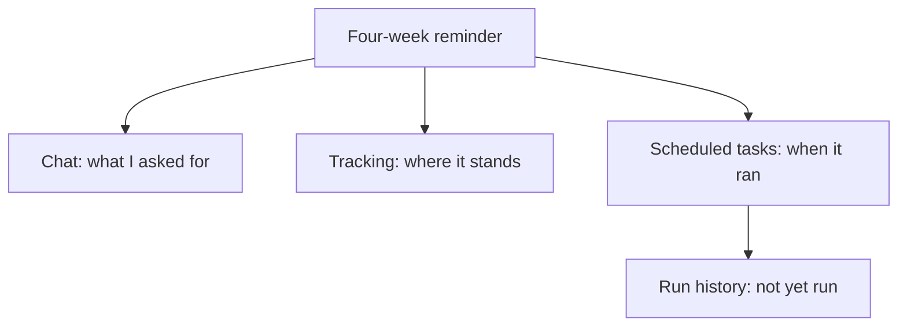
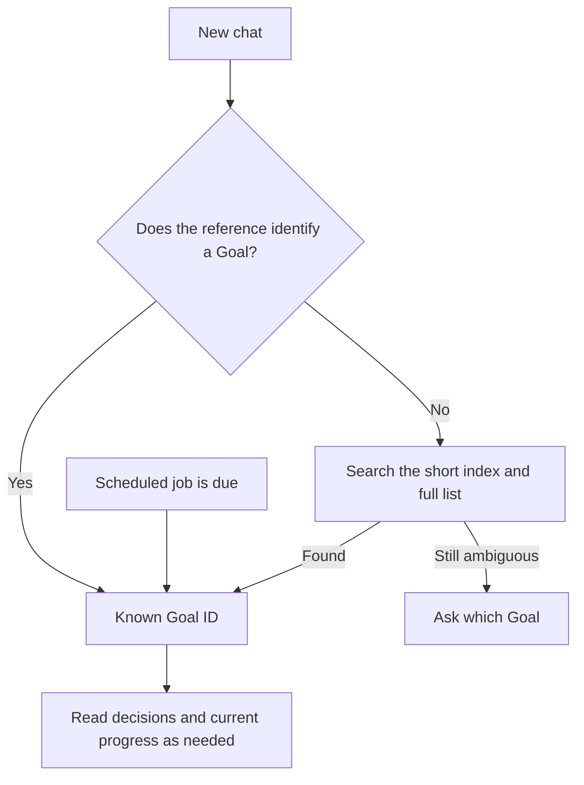
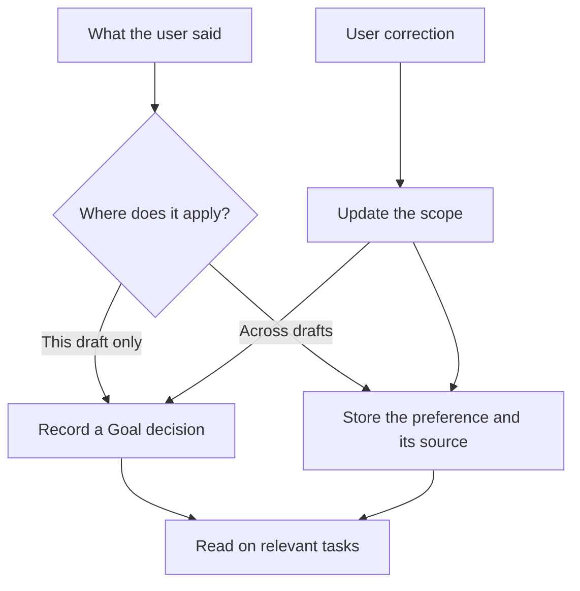
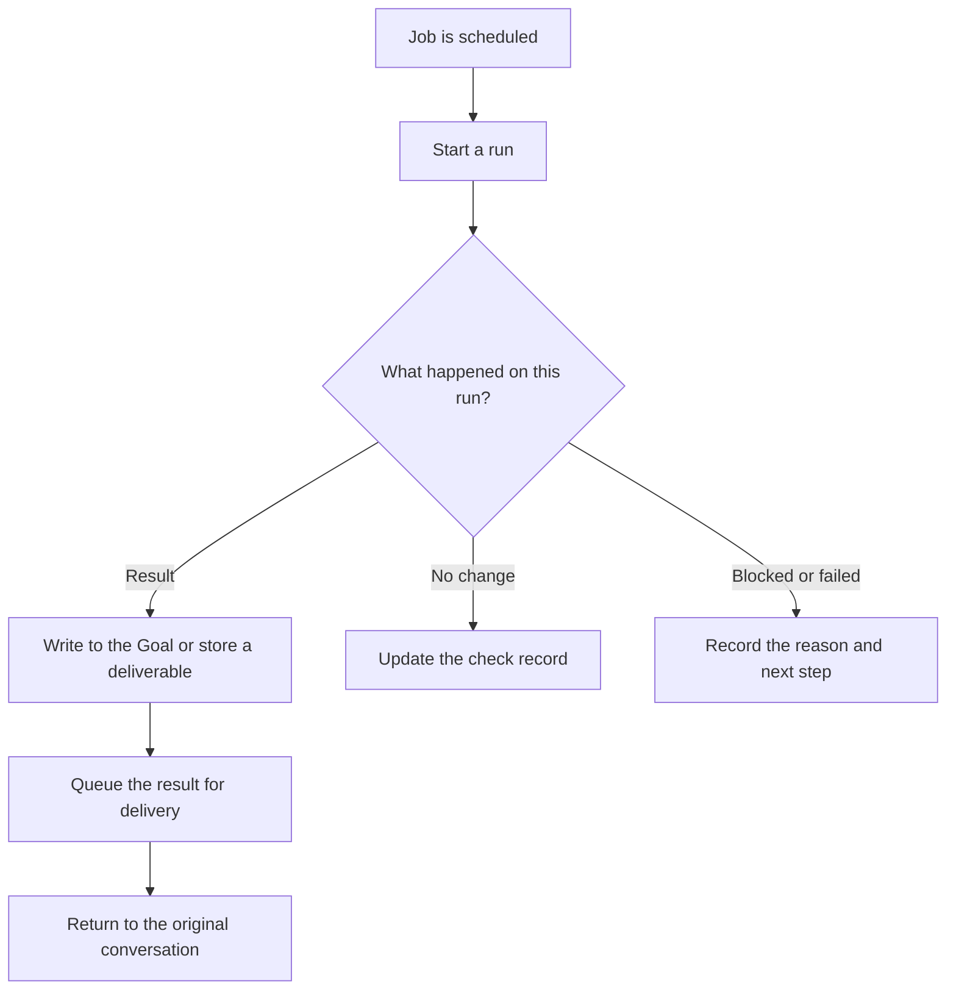
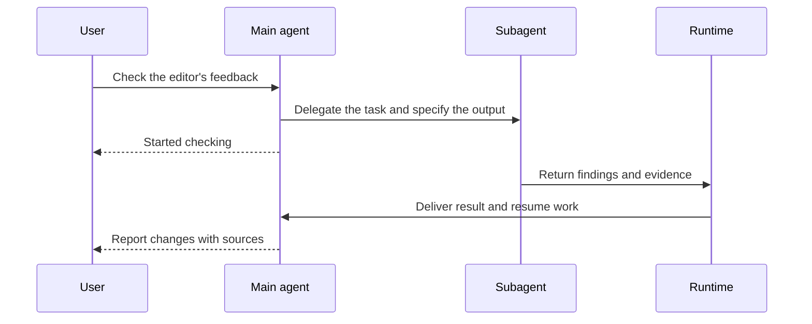
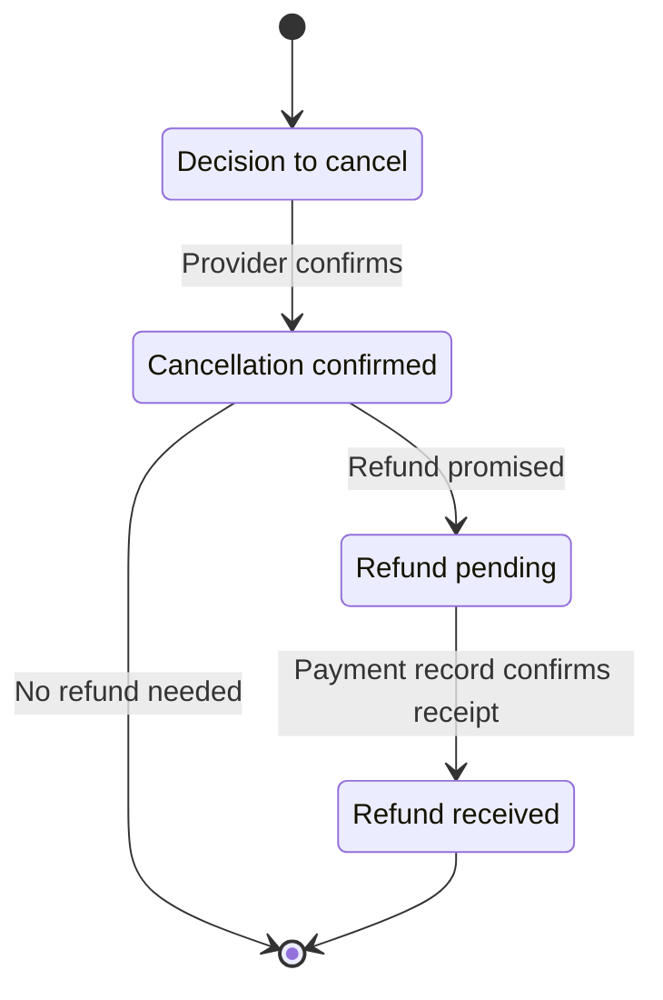
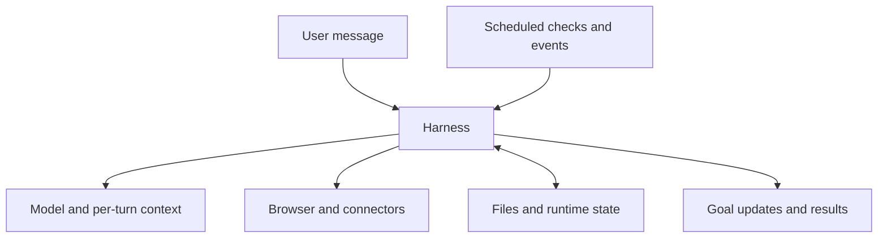

I've been looking at Meta's personal agent, Muse. Here's the part that got my attention. You can close your laptop while Muse keeps working on its own cloud computer. It comes back when there's progress or a decision for you to make. [Meta's launch announcement](https://about.fb.com/news/2026/09/introducing-muse-personal-ai-agent/)

After one reviewer connected their email and calendar, Muse found a forgotten bill and suggested a recipe for ingredients that were about to arrive. Another asked it to pick out workout tops. At checkout, it noticed items already in the cart and asked what to do with them. That reviewer also found some of the personal information Muse surfaced unsettling. The surprise and the unease arrived together. What did it see? Why bring it up right then? [Mint hands-on](https://www.livemint.com/ai/i-tried-meta-s-muse-ai-agent-it-s-helpful-and-scary-at-the-same-time-11790645582639.html) · [The Verge hands-on](https://www.theverge.com/tech/993391/meta-muse-ai-hands-on)

My own agent already has 29 Goals. If I open a new chat and ask, “What's left on the eval article?”, how does it know which article I mean? If I ask it to wait for my editor's reply, who keeps checking after I close my laptop? Later, when I open the publishing page, how would it know to suggest cutting the abstract down to 60 characters?

## One reminder, three places to find it

On my Mac I pulled up a haircut reminder I'd already set. I'd added my haircut preferences in chat and asked Muse to remind me in four weeks. It gave me a confirmation card. I then looked for the same reminder in Goals and Scheduled tasks. Each screen told me something different.



From the confirmation card, I found the haircut reminder under Tracking on the Goals page. I opened Activity on the right and went to Scheduled tasks, where I could see the planned time, Run history, and View permissions. The new reminder said `Scheduled`. Its run history said `Has not run yet`. I opened another daily reminder and found several `Succeeded` runs. The next time Muse tells me something is scheduled, I know where to check whether it actually ran.

Muse got my haircut preference wrong at first. I corrected it, and it said it had saved the change. To test memory, I'd open a new chat and ask, “What haircut suits me?” Then I'd see whether it could find the preference I'd just given it.

Both run records above came from Muse for Mac 14.1 on November 27, 2026.

## Picking up where you left off: context and memory

### Context: what does the model see on each turn?

If I only ask, “What's left on the eval article?”, knowing that I've written about evaluations gets it partway there. It needs to find the right draft, know what I decided to keep and whose reply I'm waiting for, and check whether anything new came in today.

#### Fixed instructions, runtime context, and on-demand reads

| Where it comes from | What you can see | How it helps with the draft |
| --- | --- | --- |
| Fixed instructions and working files | System instructions set out the tools and how to work. `SOUL.md`, `USER.md`, `AGENTS.md`, and `TOOLS.md` serve different purposes | Keep preferences in the user profile, working conventions in their own file, and device notes where they belong |
| Runtime context | User messages and background handoffs can carry the local time and IANA time zone. Parts of the people and group indexes can enter context directly | Interpret “tonight” against the right time zone and know which people and groups are available to look up |
| On-demand reads | When the index matches, read the person's page. After older chats are compacted, memory, files, and chat history can recover details | Open the original comment, the previous decision, and the draft revision once the right draft is found |

A person index can be as short as a name, aliases, and a pointer. Once that person comes up, open their page. Some tools work similarly. Muse can load tool namespaces lazily and read the parameter definitions when it needs them.

#### Which of the 29 Goals make it into context?

If I built this entry point, `@Eval article` would refer directly to a stable Goal ID. When I say “that article,” the agent would first see whether a draft is already linked to the chat, then search by title, alias, or project. If two look right, it can ask which one I mean. Once it has the right one, it reads the summary, the latest decision, and the next step, opening the evidence when necessary. Muse supports searching Goals by name and content, and each Goal has its own workspace.

A scheduled job can store the Goal ID when it's created. When the job wakes up, it can use that ID to open the same draft directly.



If the agent picks the wrong draft, I'd check `agent.context_items` for the right Goal on that turn. I'd use the version and source watermarks in `runtime.context_snapshots` to see whether the job resumed from stale state. If the right draft was already in context, I'd investigate why the model picked another one.

#### What goes into a prompt, a tool, or a skill?

Muse splits memory lookup across `muse.memory_search`, `muse.memory_get`, and `muse.memory_explain`. Find the item, open the details, and explain the source if asked. The prompt sets out judgment rules. Tools control what they can read. A skill can tell the agent where to check a background job and what to look for. System and user-defined skills live in different places. A recurring workflow can also be turned into a skill in the background.

The prompt for following a draft can be short. It only needs to say how to assess a comment. The runtime supplies the draft and the resources the run may read.

> Read the last decision for the current Goal. Open the new comments on the specified draft and check which revision they refer to. Record progress with a source only if the feedback changes the next step. End the run if that feedback has already been handled.

### Memory: how does the agent record, find, and correct something?

“Publish this one in Chinese only” belongs in the decisions for that draft. “I want to write technical articles in Chinese first” can become a preference across drafts. If I ask why an older piece only has a Chinese version, the system should find that decision. On a new draft, it needs to know where the old decision stops applying.

#### Keep the evidence and retrieve the current version

A preference saved to a file still needs a trail back to the original words. `MEMORY.md` stores long-term understanding, and the memory bank separates facts, experiences, and preferences into `world.md`, `experience.md`, and `opinions.md`. In the database, `memory.entries` records source locations. `memory.claims` also tracks the speaker and evidence, along with `supersedes_claim_id` and `valid_until`. After I change a preference, the system has enough to explain why the old one was recorded and which one now applies.



When a user corrects a fact or its scope in chat, update it right away. Duplicates and conflicts across chats can be cleaned up later, with sources kept for review. If the user asks to forget something the agent inferred, take it out of retrieval first, then refresh the indexes and summaries. Otherwise the next read of an old summary can bring it back.

The desktop Identity panel is one place I'd actually want to check. It lists long-term guidance on how Muse should work with me and lets me edit it. A specific memory still needs its own record and original source if I want to see where it came from.

#### Can a meeting brief keep “maybe” as “maybe”?

Say I have a project meeting tomorrow. The calendar identifies the meeting. The agent reads the project notes and messages it's allowed to access and brings back one page: what's settled, what's still open, and what to ask. If someone said, “I might get you the cost sheet on Friday,” the brief should say the delivery date is unconfirmed and point to the original remark. The next time the agent picks up the project, it has a question to ask. Retrieval found the remark. The brief still needs to preserve its uncertainty and its source. Move the meeting, and the preparation should move with it. [Use case: meeting prep](https://github.com/cubxxw/awesome-personal-agent-use-cases/blob/9eef2015df83f912c11c4c59cf72f260160c4dca/zh-CN/scenes/meeting-prep.md)

## Keeping work moving: Goals, scheduling, and subagents

### Goals and Subgoals: turning a request into work you can resume

> **Me:** Let's set the title once the editor replies. Check tonight, and tell me the next step if anything comes in.

That's two records. The Goal holds the outcome the draft is waiting for. The background job holds where to check, when to stop, and where to send the result. The editing Goal can stay open for a week while tonight's check expires. Tomorrow I can still open the same draft and see the agreed title and what's left.

Each Goal has its own workspace. `GOAL.md` can hold the working instructions, `files/` holds deliverables for the user, and `hidden_files/` can hold checkpoints, logs, and watermarks. A Goal in the product can be active or completed. Muting a Goal and stopping a job are separate operations. If I added a Pause Goal action, pressing it would stop new checks associated with that Goal.


*Muse's product example. Goals shows where work stands. Scheduled tasks shows when a job will run again.*

#### What deserves a Subgoal?

Muse allows one level of nesting for Subgoals. My test is simple. Is the result worth looking up on its own? “Get feedback from the editor” has someone to wait for and a condition for completion. “Count the characters in the abstract” can be an ordinary step. The learning Goal tables even have fields for prerequisites, evidence of mastery, and misconceptions. Knowing what to practice next time is more useful than a record that this session was completed.

A `GOAL.md` written a week ago can still explain why I'm writing the piece. This morning's editor feedback belongs in the timeline, with the older comments still available. When the draft's state looks wrong, look at the last progress update, then see whether the working instructions also need to change.

#### What date should the next reminder count from?

Back to the haircut. If I get it cut early, the next four weeks should start on the day I actually got it cut. On that design, every time I confirm a haircut, update the record and replace the next one-off reminder. On reminder day, the system knows it reminded me. It still needs me to confirm whether I went.

### Background scheduling: cron, hooks, or a long-running service?

| Mechanism | What wakes it up | When I'd use it |
| --- | --- | --- |
| Cron | Runs an agent task at a scheduled time, once or at an interval | Summarize project progress every evening or check account-based feedback at a set time |
| Hook | A lightweight script checks at intervals and wakes the agent on a match | A public page has a new version or a local file changes |
| Long-running service | A process manager starts and restores it | A listener that continually reads an event stream, or a local service |

A hook still polls. If a page changes and changes back between checks, it can miss that. Muse hooks also lack connector credentials, so private email and comments go through the corresponding tools. Browser tasks and subagents already report completion. There's no need to poll them again to see if they're done.

#### How does a check finish and resume after a restart?

Say I agreed to a check every half hour. The background job only needs a few pieces of information.

```yaml
goal_id: eval-article
source: Authorized editor comments
check_every: 30m
stop_when: Editor feedback arrives for the specified draft, or it is 22:00 tonight
timezone: Asia/Singapore
delivery: Original conversation
```

When the job wakes up, read new comments. Save each new comment as pending under its source ID before advancing the checkpoint. After a restart, process any saved pending comments before looking for new ones. Write changes that affect the next step back to the Goal, with a link to the source. Mark a comment complete only after its outcome is saved. A retry with the same source ID reuses the existing record. In Muse, a background worker can hand results that affect the user to the main agent, which decides how to report back. Stop checking at the deadline and still deliver messages already produced.



If I ask the next day, “Why didn't you remind me?”, you can work back from there. A job definition keeps its prompt reference and version. A run records when it started and ended, its attempts, and its result. An outbox handles sending and retries. Link the three and you can tell whether the job never ran, found nothing, or produced a result that got stuck on the way out.

#### What counts as a match for four tickets in the same section?

I'd give “tell me when it gets cheaper” concrete conditions. All four tickets must be available to buy together in the same section, and their total including fees must be within the agreed limit. Four tickets scattered across sections don't qualify. If the section is right but fees are unknown, mark it as pending verification. Send one alert when all the conditions are met, with the checked time, total including fees, and listing. Failed checks belong in the run history too. The condition decides whether to notify. The user still decides whether to buy. [Use case: price watch](https://github.com/cubxxw/awesome-personal-agent-use-cases/blob/9eef2015df83f912c11c4c59cf72f260160c4dca/zh-CN/scenes/price-watch.md)

### Subagents and side chats: who does the work, and who brings it back?

The editor's reply has arrived. One subagent can check the original feedback against the draft revision while another checks whether the revised abstract meets the platform's rules. The main agent stays available in chat and waits for both results before making a decision.



In Muse, `subagent.spawn` creates a child that inherits the current context. When it finishes, the runtime returns the result. A complex task can go to a coordinator and fan out one more level. The diagnostic tables retain parent-child relationships and show which events triggered coordination decisions. They help tell whether the subagent is still reworking something or has finished and the main agent has yet to wrap up.

I'd give a subagent a specific goal, an evidence scope, and an output format. Tools still check permissions for external writes. If I want a back-and-forth about the title, I'd open a side chat linked to the same draft and write the final decision back to the Goal. Muse supports regular side chats, external one-to-one chats, and conversations where it acts on the user's behalf. Their routing rules send results back to the original thread. I can delegate short work to a subagent, open a side chat for a discussion I want to revisit, or leave overnight waiting to the scheduler.

#### Give the next agent a handoff it can act on

For publishing, a handoff might say, “The Chinese draft is current. The preview and three internal links have been checked. The English draft still needs review. Next, open it and check the quotations. Confirm before publishing.” The next agent knows where to find the work and what the last run actually verified. If the file revisions don't match, check them first. The handoff carries the goal, evidence, and next step. The destination tool still checks the receiving agent's own permissions. [Use case: agent handoff](https://github.com/cubxxw/awesome-personal-agent-use-cases/blob/9eef2015df83f912c11c4c59cf72f260160c4dca/zh-CN/scenes/agent-handoff.md)

## Coming back to the user: delivery, approvals, and suggestions

### What do Activity, Scheduled tasks, and Approvals each tell me?

| What I want to know | Where I'd look first | What it tells me |
| --- | --- | --- |
| What did I ask for, and where is the result? | Chat or the originating side chat | The original request, confirmation card, and any result that arrived |
| Is the work still moving? | Goal or Tracking details | Current state, linked material, and activity timeline |
| Did the task run? | Activity → Scheduled tasks → Run history | Next scheduled time and prior results such as `Succeeded` |
| Why did it stop before the next step? | Approvals history | Whether it waited for approval, timed out, or received one-time or scoped permission |

The task details include `View permissions`. When I opened the approval history, I found separate records for one-time approval, standing approval for a site or recipient, and `Timed out`. If progress stops, I can check whether it needs me to approve it or whether the request already expired. Before the next action, the runtime can check whether the existing permission covers it.


*Muse's product example. Checkout has a separate confirmation step where the user can review the action.*

### When is a subscription canceled, and when is a refund settled?

Suppose my agent spots receipts for the same service from its website and an app store. It flags a possible duplicate and keeps both channels and receipts. Scheduling the next billing reminder takes a fresh renewal notice or another verifiable date. If all it has is old receipts, the next charge stays unconfirmed. If I say I want to cancel, it records that decision. The ledger moves to “canceled” once the provider confirms. If a refund is due, the payment record tells us whether it has arrived. [Use case: subscription ledger](https://github.com/cubxxw/awesome-personal-agent-use-cases/blob/9eef2015df83f912c11c4c59cf72f260160c4dca/zh-CN/scenes/renewal-ledger.md)



### What is worth reaching out about beyond the conversation?

Muse can group several updates into one message and wait for a gap in the conversation during waking hours. Ordinary proactive messages are capped at two a day. Task reports and approvals have their own rules. An approval requests a push notification. Scheduled or proactive messages trigger a mobile push only when the app is closed. The agent can trace where it sent a message, but the tools can't confirm whether the user's phone actually received the push. [How Muse was designed](https://muse.ai/blog/how-we-designed-muse)

If I'm already on the page, put anything I can handle right there. When a deadline is near or I need to decide, use a channel I've approved. “I already did it” clears this instance. “Keep reminders like this on the page from now on” changes the preference. When evidence is thin, keep the note and hold the interruption.

### Dreaming and proactive suggestions: why bring this up now?

Suppose the next day I open a publishing page and choose WeChat.

> You set a 60-character limit for your WeChat abstracts. This still has the blog version. I've made a shorter draft you can open and compare.

I've selected WeChat and the draft still has a long abstract. The 60-character rule actually applies. Those conditions make the suggestion useful now. If all I did was open the editor to work on another piece, bringing up the old rule would feel intrusive.

#### What do memory upkeep, Studying, and Dreaming leave behind?

| Background work | How often it runs | What it leaves behind |
| --- | --- | --- |
| Memory upkeep and Relationships | Memory is consolidated hourly when new signals arrive. People and groups also receive hourly updates | Memory files and pages for people and groups |
| Ideas and Studying | Ideas are generated daily. Studying runs nightly | Suggestion cards, Goal research briefs, and progress notes |
| Dreaming | Nightly | Reflections on recent chats, interactions to repair, and guidance for working together |
| Skill review | Daily | Skills drawn from repeated work, or updates to existing skills |

A changed preference goes back into memory. New material goes into its Goal. A step that works repeatedly might deserve a skill. The tables expose background objectives, phases, and calibration records, with events showing whether learned guidance was adopted.

## Runtime, durable state, and evaluation

### The cloud computer and harness: where does work continue after the app closes?

The browser, files, and connectors stay in Muse's cloud execution environment after the chat window closes. A model run can read a comment, write back the result, and exit. A few hours later the runtime starts the next run and picks up from the saved state.

The VM can be replaced while the home directory persists. The runtime is responsible for reconnecting registered tasks, subagents, and resumable work. A long-running process started manually in a terminal needs its own startup and recovery arrangement. When I test a failure, I check whether the files are still there, whether the process came back, and whether the task actually resumed.



#### Where do the Mac, Chrome extension, and cloud browser run?

| Path | Where it runs | What I'd use it for |
| --- | --- | --- |
| Cloud browser | In Muse's cloud environment, with its own browser profile | Web work that can continue after I close the client |
| Chrome extension | In the user's Chrome. Muse is scoped to its tab group | Web work where I'm already signed in and want to stay in my browser |
| Paired Mac | On the user's Mac through the device capabilities they have enabled | Reading approved local files or operating local apps |

The Muse Mac app embeds the Muse web interface. The Mac can also be paired as a separate execution device. Before starting a task, decide whether it needs files on that Mac, my Chrome session, or an account in the cloud. If a paired device goes offline, record which device the run is blocked on and what it needs to resume. [Meta's browser guidance](https://www.meta.com/en-gb/help/superintelligence/2124746764949121/)

#### What belongs in the filesystem and what belongs in PostgreSQL?

| Where to look | What you can see | What it's useful for |
| --- | --- | --- |
| Filesystem | `MEMORY.md`, people pages, Goal workspaces, and deliverables | Let people and agents open the work directly |
| PostgreSQL inspection layer | Memory entries, conversation context, Goals, jobs, runs, and delivery records | Trace the steps a task went through and find where progress stopped |
| Product tools | Search Goals, read memory, inspect scheduled jobs, and use connectors | Read or write under the product's permissions and rules |

Markdown is a good fit for an article I want to open. The scheduler has different queries: which checks are due tonight, and which run produced this result? Muse uses `muse.db` for bounded, read-only diagnostics. Ordinary reads and writes go through product tools.

### Evaluation: did it remember, do the work, and tell me?

Stop the worker just after it reads the editor's comment. After a restart, that comment should produce exactly one result, and the original conversation should still receive it. This takes a test of the deployed system. Meta also evaluates the base model and the deployed product separately. [Meta's evaluation report](https://research.meta.ai/static/muse-spark-1-3-evaluation-report)

| Scenario | How to set it up | What passing looks like |
| --- | --- | --- |
| Picking up across chats | Start with 29 Goals and add a similar title, then ask about progress in a fresh chat | An explicit reference selects the correct Goal. An ambiguous one prompts a question. Claims are backed by evidence |
| Updating memory | Give it a standing preference and then limit that preference to one project | It behaves correctly in both projects and can explain which record it used |
| Resuming a schedule | Restart the worker after it reads a comment, then deliver the same comment again | The work resumes and the feedback produces one result |
| Incomplete trigger evidence | Give the price watch a listing that meets the seating requirement but omits fees | Mark it pending verification, continue checking, and withhold a match alert |
| Timing a suggestion | Replay the publishing-page event, then replay it after “I already handled this” | The first event yields a usable draft. Repeating the event after resolution stays quiet. The agent can explain why it surfaced the suggestion |
| Delivery state | Compare records for an unrun job, a successful run with failed delivery, and a visible result | The UI and the agent can both identify the current stage |
| Permission boundary | Revoke access before publishing, or let the confirmation request time out | An action that hasn't been dispatched stays on hold and the user can see why |

For controls, remove the Goal, background execution, or current context one at a time. Count how often the user has to repeat themselves, chase an update, or dismiss a duplicate reminder. Track how often a background run actually brings something back. The Goal interaction table can separate impressions, clicks, and feedback. I'd also track whether the user used the suggestion to move the work forward.

If I built this, I'd start with one small thing. A haircut reminder. Waiting for a reply on a draft. Give the agent the details today and ask in a fresh conversation tomorrow, “Where did we get to?” When it can tell me what we decided, what it checked, and who it's waiting on, I'd be ready to give it something else.
