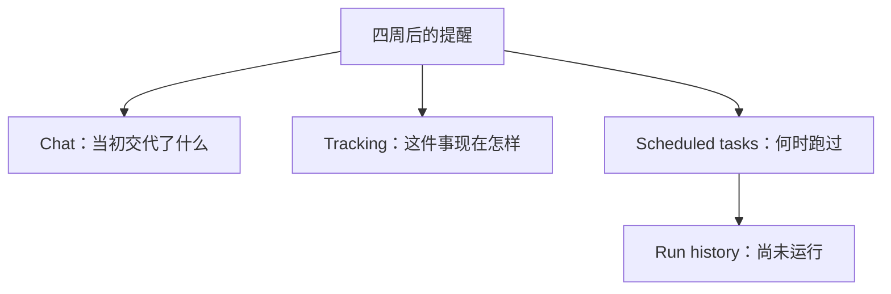
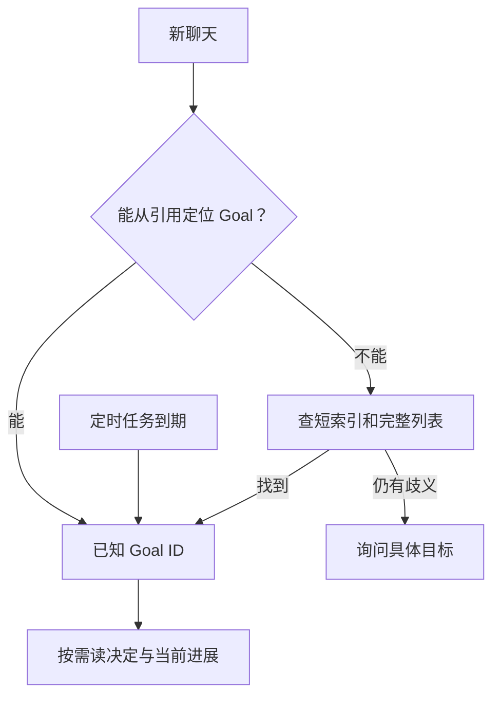
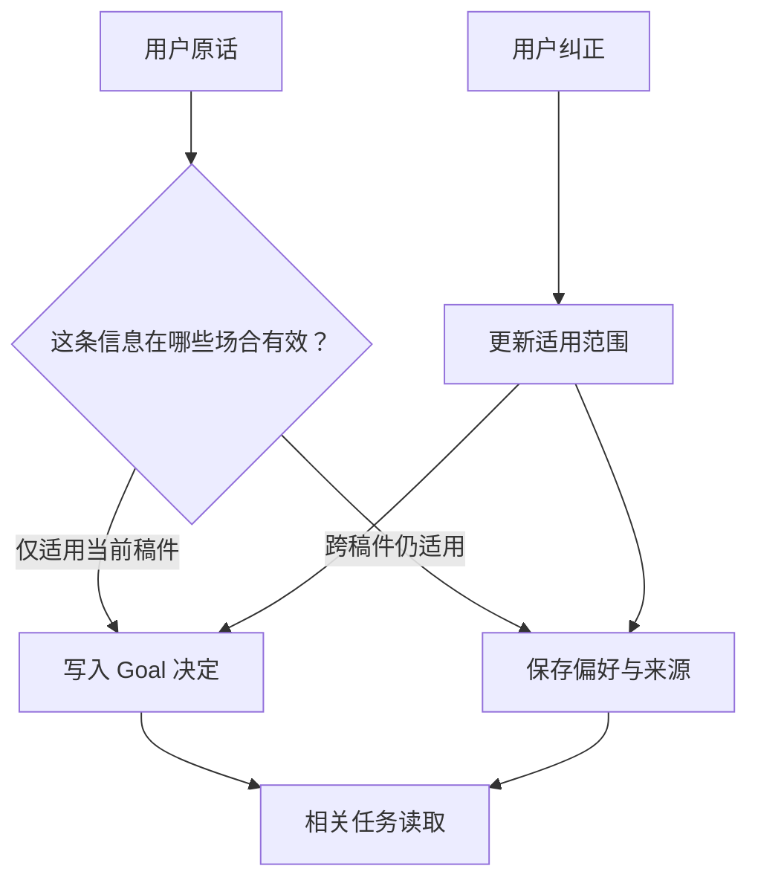
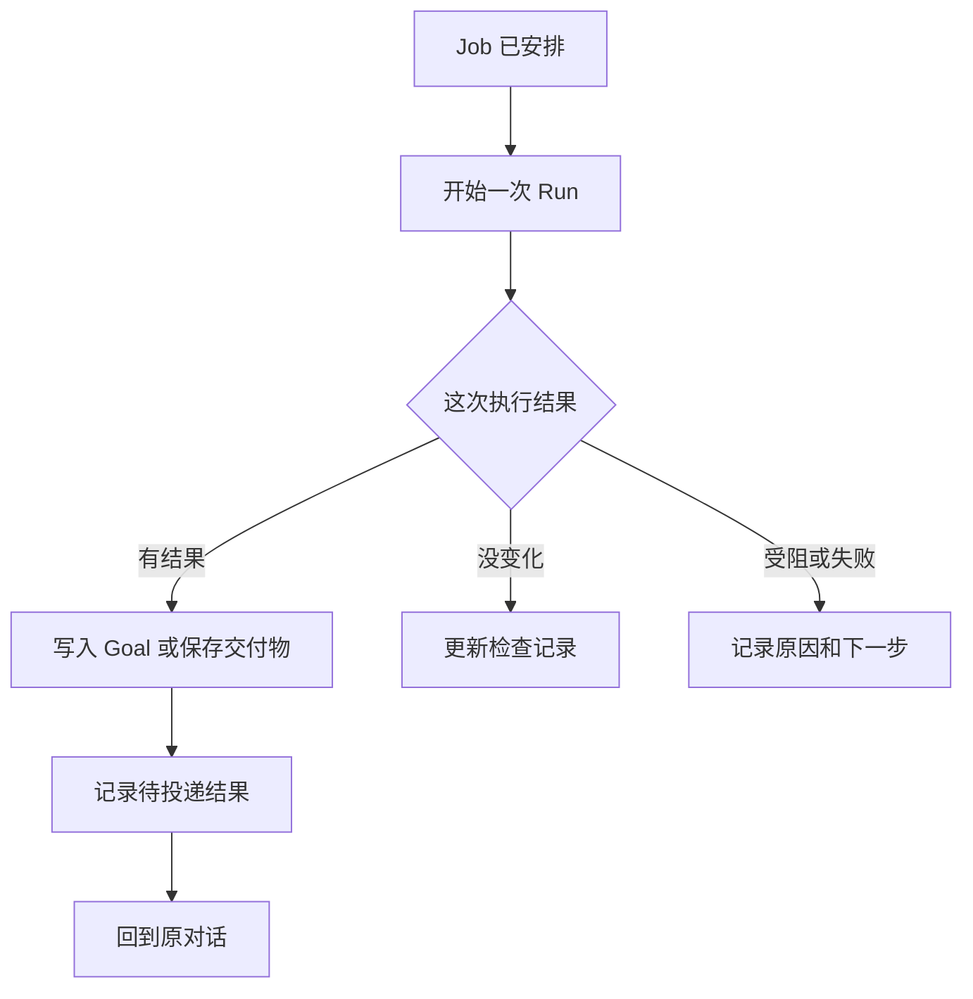
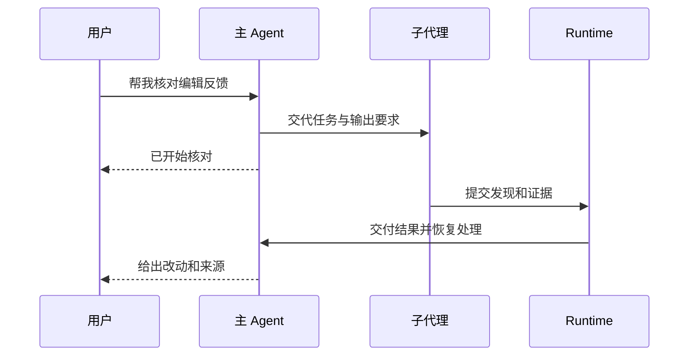
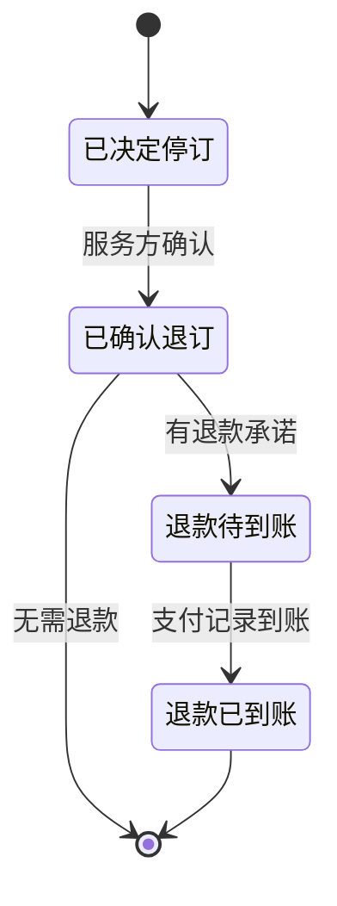
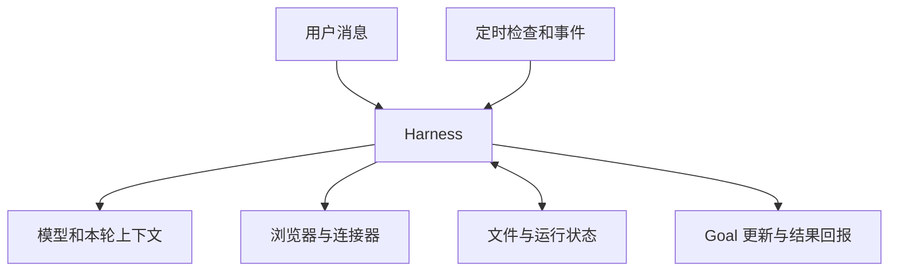

家人们，最近我一直在看 Personal Agent，今天想聊聊 Meta 的 Muse。它有一台独立的云电脑，可以开浏览器、连账户、处理文件。你把事情交给它，关掉 App，它还可以继续推进。有了变化，或者到了需要你做决定的地方，它再回来找你。[Meta 产品发布](https://about.fb.com/news/2026/09/introducing-muse-personal-ai-agent/)

我看了几篇媒体实测。有位试用者接入邮箱和日历后，Muse 找到一笔遗忘的账单，还根据即将到货的食材推荐了菜谱。另一位让它挑运动上衣，它在结账前发现购物车里还有原先的商品，先问怎么处理。同一篇实测里，试用者也说，有些被它翻出来的个人信息让自己感到不安。惊喜和不安来得很近。它看到了什么？为什么偏偏在这个时候提起来？[Mint 实测](https://www.livemint.com/ai/i-tried-meta-s-muse-ai-agent-it-s-helpful-and-scary-at-the-same-time-11790645582639.html) · [The Verge 实测](https://www.theverge.com/tech/993391/meta-muse-ai-hands-on)

Meta 测过基础模型，也单独测部署后的产品。我想试一件日常的事。隔天再打开，它还记得我在做什么吗？该它来找我的时候，它会回来吗？

我自己的 Agent 里已经有 29 个 Goal。换个对话问一句「评测那篇还差什么」，它要怎么知道我在说哪篇？如果我让它等编辑回复，电脑合上以后，谁记得去看？再往后，我打开发布页，它又凭什么建议我把摘要缩到 60 字以内？

## 实测：同一条提醒在 Muse 里有三个入口

我在 Mac 上翻到之前设的一条剪发提醒。那天我在聊天里补充了自己的剪发偏好，请 Muse 四周后提醒我。它给了一张确认卡。我又去 Goals 和 Scheduled tasks 找了同一件事，才发现这三页各管一段。



从确认卡往下找，剪发提醒在 Goals 页的 Tracking 里。打开右侧 Activity，再进 Scheduled tasks，就能看到预约时间、Run history 和 View permissions。新提醒写着 `Scheduled`，展开运行记录是 `Has not run yet`。我又点了另一条日常提醒，里面已经有几次 `Succeeded`。以后 Muse 跟我说「安排好了」，我知道去哪里看它究竟跑过没有。

这段聊天还有一处小插曲。Muse 一开始没有用上我后来补充的偏好，判断错了。我把偏好补给它，它当场更正，说已经存好。做到这里，只能看出它当场改了。等换一个对话，再问一次剪发的事，才知道它能不能把那份资料找回来。

上面两条运行记录都来自 2026 年 11 月 27 日的 Muse Mac 14.1。

## 记住一件事：Context 和 Memory

### Context：模型每一轮究竟看见什么？

我如果只问「评测那篇还差什么」，光知道我写过评测可不够。它得挑对稿子，知道上次保留了什么、还在等谁回，以及今天有没有新消息。

#### 固定指令、运行时注入和按需加载

| 从哪里来 | 能看到的做法 | 在跟稿里怎么用 |
| --- | --- | --- |
| 固定指令和工作文件 | 系统指令规定工具与工作方式。`SOUL.md`、`USER.md`、`AGENTS.md` 和 `TOOLS.md` 各有用途 | 把用户偏好留在用户资料里，把工作约定和设备笔记留在各自的文件里 |
| Runtime 注入 | 用户消息和后台交接可带本地时间与 IANA 时区。人物、群组的部分索引可以直接进入上下文 | 对「今晚」有明确的时间基准，先知道有哪些人和群组可查 |
| 按需读取 | 命中索引后读对应人物页。旧对话压缩后，可通过记忆、文件或聊天记录找回细节 | 找到稿件后才展开原评论、上次决定和稿件版本 |

人物索引里留名字、别名和入口就够了。聊到这个人，再打开对应的页面。工具也有类似做法，部分工具按命名空间延迟加载，用到才读参数定义。

#### 29 个 Goal 怎么选进来？

如果我做这个入口，`@评测文章` 会直接指向一个稳定的 Goal ID。只说「那篇」，先看这段对话有没有关联稿件，再用标题、别名或项目找。两篇都像，就问我是哪一篇。选中后先读简述、当前决定和下一步，有疑问再展开证据。Muse 支持按名称和内容搜 Goal，也给 Goal 留了自己的工作区。

我问过 Muse 当时加载了几个 Goal。它在聊天里答，26 项 Tracking 中有 15 项摘要进了上下文，其余用列表或搜索找。桌面端也会折叠 Tracking 项。要验证模型实际读到多少，得看那一轮发给模型的请求。

聊天里的「那篇」要先查指的是谁。跟稿的定时任务在创建时就能记住所属的 Goal ID，到点直接打开同一份记录。界面上多几个 Goal，也不需要它挨个翻。



真要排查「它怎么找错了」，我会先看这一轮喂给模型的内容。Muse 的表里有按顺序记录的 `agent.context_items`、恢复用的上下文投影，以及记着版本和源水位的 `runtime.context_snapshots`。拿这些区分历史、恢复时所需的信息和已经过时的视图，才好判断是资料根本没找回来，还是模型看到了却理解错了。

#### Prompt、Tools 和 Skill 分别该写什么？

查一条记忆这件事，Muse 拆成了 `muse.memory_search`、`muse.memory_get` 和 `muse.memory_explain`。先找得到，再打开详情，问到来源时还能解释。Prompt 里写判断规则，工具管自己能读什么。Skill 可以记下查一次后台任务要去哪看、要核对哪几项。系统 Skill 和用户自定义 Skill 分开存，重复的做法也可以在后台整理成 Skill。

跟稿的任务 Prompt 可以写得很短，交代怎么判断评论就行。要跟哪篇稿、能读哪份资料，由 Runtime 启动时带进来。

> 先读当前 Goal 的上次决定。打开指定稿件的新评论，确认它针对的版本。只有反馈改变了下一步，才写回进展并附上来源。同一条反馈已经处理过，就结束这轮。

### Memory：一条信息怎样被记住、找到和纠正？

跟稿时说「这篇只发中文」，应写回稿件的决定。「今后技术文章先写中文」才适合成为跨稿件的偏好。以后问「那篇为什么只写了中文版」，系统要能找到那次决定。当我换一篇稿子时，它还要知道原决定的适用范围。

#### 写入时保留证据，读取时拿当前版本

偏好写进文件后，也得找得到原话。`MEMORY.md` 存长期理解，记忆库还把事实、经历和偏好分别放进 `world.md`、`experience.md`、`opinions.md`。数据库里的 `memory.entries` 记来源位置，`memory.claims` 还记说话者、证据、`supersedes_claim_id` 和 `valid_until`。我改过一条偏好，系统仍然能说明之前为什么那样记、现在是哪条生效。表里也有 embeddings，单凭这一点还看不出实际检索怎么混合、怎么排序。



用户当场纠正某条事实或它的适用范围，这笔应该立即改。跨对话的重复内容和矛盾，可以交给后台慢慢收拾，留着出处给人核对。用户要求忘掉一条理解，先让检索拿不到它，再更新索引和摘要。否则旧摘要一重读，它又回来了。

桌面端的 Identity 让我愿意点开看一眼。它把长期协作说明一条条列出来，也能编辑。用户能纠正它打算怎么和自己协作。要查具体某条记忆从哪来，还得回到记忆条目和原文。

#### 会前卡怎么避免把「也许」写成「答应了」？

假设我明天要开项目会。日历告诉 Agent 是哪场会，它再读这个项目授权的纪要和消息，带回来一页「已定、未定、这次要问」。如果上次有人说「我也许周五能给成本表」，卡片应该写「交付日期待确认」，并给出原话的位置。这样，下次 Agent 再接到这个项目时，也知道该问什么。这里检索命中了还不够，它还要保留原话的语气和证据。会议改期，准备时间跟着更新。[案例库 · 会前卡](https://github.com/cubxxw/awesome-personal-agent-use-cases/blob/9eef2015df83f912c11c4c59cf72f260160c4dca/zh-CN/scenes/meeting-prep.md)

## 继续推进：Goal、Scheduler 和 Subagent

### Goal 和 Subgoal：把一句委托变成可以接续的工作

> **我**　这篇等编辑回了再定标题。今晚帮我看一下，有消息就把下一步整理给我。

这里有两件事。Goal 记下「稿子等什么结果」，后台 Job 记下「去哪里查、查到几点、结果发到哪」。定稿 Goal 可以留一周，今晚的检查到期就停。明天仍能打开这篇稿件，查看已经确认的标题和剩下的事。

每个 Goal 有自己的工作区。`GOAL.md` 可以放工作说明，`files/` 给用户看成果，`hidden_files/` 留检查点、日志和水位。产品里的 Goal 可以进行中或完成。给 Goal 静音和停掉一个 Job 是两次不同的操作。如果做「暂停 Goal」，我希望按下去，新一轮关联检查就停。


*Muse 官方示例。进 Goals 看一件事走到了哪里，查下一次什么时候跑则打开 Scheduled tasks。*

#### 哪些东西值得变成 Subgoal？

Muse 的 Subgoal 只往下嵌一层。我一般用一个问题来判断要不要拆。它拿到的结果，值不值得单独查？「拿到编辑反馈」有自己的等待对象和验收条件。「数一遍摘要字数」做完就行。学习类 Goal 的表里甚至有前置知识、掌握证据和误解。下一次该练哪一块，比只记这次「做完了」更有用。

一周前写的 `GOAL.md` 今天仍能解释为什么写这篇。编辑今早发来的意见应进活动记录，旧意见也还找得到。稿件状态出问题，先看最后一条进展，再看说明需不需要跟着改。

#### 下一次提醒从哪一天算？

回到剪发这件小事。如果我提前剪了，下一次应该从我实际剪完的日期算四周。按这个规则，每次我确认剪完，就更新记录，再换一条单次提醒。到了提醒日，系统只知道自己提醒过，我到底剪没剪还得等我说。这次在桌面端看到的是已安排的一条提醒，后面的顺延是我的做法。

### 后台调度：Cron、Hook 和常驻服务怎么选？

| 机制 | 怎么唤醒 | 适用场景 |
| --- | --- | --- |
| Cron | 到点跑一次 Agent 任务，可以单次或按间隔 | 每晚整理项目进度，或到点检查需要读账号的反馈 |
| Hook | 轻量脚本按间隔检查，匹配后才唤醒 Agent | 公开页面出现新版本，或本地文件变了 |
| 常驻服务 | 由进程管理器启动和恢复 | 需要持续读取事件流的监听器或本地服务 |

Hook 隔一段时间才查一次。如果页面两次检查之间变了又改回去，它会错过。Muse 的 Hook 也拿不到连接器凭据，私有邮箱或评论就走对应的工具。浏览器任务和 Subagent 做完本来就会回报，省得再开一轮轮询追着问。

#### 一次检查怎么跑完，重启后怎么继续？

假设我同意每半小时查一次，交给后台的 Job 只要写清这几件事。

```yaml
goal_id: eval-article
source: 已授权的编辑评论
check_every: 30m
stop_when: 收到指定稿件的编辑意见，或今晚 22:00
timezone: Asia/Singapore
delivery: 原对话
```

这轮醒来就去读新评论。先按源 ID 把新评论记成待处理，再往前挪检查位置。重启后先捞出没处理完的评论，再去查新的。真正改变下一步的内容写回 Goal，带上原文。等处理结果落盘，再把这条标成完成。同一源 ID 重试时沿用原记录。Muse 的后台 Worker 可以把影响用户的结果交给主 Agent，由它决定怎么回报。检查到期后停止查询，已经生成的消息继续投递。



如果第二天我问「昨天怎么没提醒」，得一段段往回查。Job definition 会留下 Prompt 引用和版本。Run 记实际开始和结束的时间、试了几次、结果是什么。还有一张 outbox 专门管发消息和重试。三处串起来，才知道是那轮没跑、没看到新东西，还是结果有了却卡在发送。

#### 盯四张同区球票，什么时候才算命中？

我会把「便宜了叫我」写成具体条件。四张票要能在同一区域一次买齐，四张含手续费的总价不超过约定上限。只找到四张分在不同区，这次没有命中。区域符合但手续费未知，状态是「待核对」。全部满足才发一次提醒，附检查时间、含费价格和原页面。每次查询失败也留在运行记录。这个例子能看出，Cron 负责再次检查，条件决定是否提醒。收到提醒后，是否下单仍由用户决定。[案例库 · 降价盯梢](https://github.com/cubxxw/awesome-personal-agent-use-cases/blob/9eef2015df83f912c11c4c59cf72f260160c4dca/zh-CN/scenes/price-watch.md)

### Subagent 和 Sidechat：谁并行做事，谁负责把结果交回来？

编辑的回复到了，有两件可以分开做的事。一个子代理核对编辑原话和稿件版本，另一个检查拟改摘要是否符合平台要求。主 Agent 继续接我的消息，等两份结果回来再做决定。



在 Muse 里，`subagent.spawn` 启动的子代理继承当时的上下文。它做完后，Runtime 把结果送回来。复杂任务可以先派给 coordinator，再由它往下发一层。诊断表留着父子关系，也能看到哪个事件触发了协调决定。这样一查就知道是子代理还在返工，还是做完了、主 Agent 还没收尾。

交给子代理时，我希望它拿到具体目标、证据范围和结果格式。外部写入仍由工具校验。我自己要来回讨论标题，就开一段 Sidechat，挂同一个稿件引用，定下来再把结果写回 Goal。Muse 有普通 Sidechat，也有外部一对一和代办会话，结果按规则回到原线程。短活可以交 Subagent，想随时回去聊的话就开 Sidechat。跨夜等反馈，另有 Scheduler。

#### 换一个 Agent，给它一张可以开工的交接单

拿文章发布举例。交接时写「中文版是当前稿件，已核对预览与三个内部链接。英文版待审，下一步打开英文稿核对引文。发稿需确认。」接手的 Agent 能直接找到产物，也知道前一轮只验证过哪些内容。文件版本对不上，就先核对版本。交接单能传递目标、证据和下一步，目标工具仍要检查接手方自己的权限。[案例库 · Agent 交接单](https://github.com/cubxxw/awesome-personal-agent-use-cases/blob/9eef2015df83f912c11c4c59cf72f260160c4dca/zh-CN/scenes/agent-handoff.md)

## 回来找用户：交付、审批和主动推荐

### Activity、Scheduled tasks 和 Approvals 分别回答什么？

| 碰到的问题 | 我会先打开哪里 | 能确认到什么 |
| --- | --- | --- |
| 我当初交代的内容和结果在哪？ | Chat 或发起任务的 Sidechat | 原始委托、确认卡和已经回来的结果 |
| 这件事还在推进吗？ | Goals 或 Tracking 的详情 | 当前状态、关联材料和活动时间线 |
| 任务有没有执行过？ | Activity → Scheduled tasks → Run history | 下次运行时间及已有运行结果，例如 `Succeeded` |
| 为什么没有继续做下一步？ | Approvals history | 是否等过批准、是否超时、授予的是一次还是某个范围的许可 |

任务详情里有个 `View permissions`。我顺手翻了审批历史，一次性允许、站点长期允许、收件人长期允许和 `Timed out` 都是分开记的。事情停了，我能点进去查是等我点头还是已经超时。下一轮要动手，Runtime 还能重新看那次许可的范围够不够。


*Muse 官方示例。结账前单独确认，用户可以检查这次要执行的动作。*

### 订阅台账怎么分清决定、退订和到账？

假设 Agent 从收据里发现我在官网和应用商店都给同一个服务付过费。它先标「疑似重复」，保留两边的渠道和收据。安排下次扣款提醒要有新的续费通知或其他可核对的日期。只有历史收据时，下次扣款日先留待确认。我点头说想停订，它记下我的决定。台账要看到服务方的确认才改成「已退订」，需要退款时，再用付款记录确认钱是否到账。[案例库 · 订阅台账](https://github.com/cubxxw/awesome-personal-agent-use-cases/blob/9eef2015df83f912c11c4c59cf72f260160c4dca/zh-CN/scenes/renewal-ledger.md)



### 哪些内容值得在对话之外触达用户？

Activity 可以翻执行过程，Goals 留长期进展，得当场决定的动作会弹审批卡。Feed 新帖则留在 Feed。Muse 允许普通主动消息合并几件事，按清醒时段和对话空档安排，文档给的预算是每天最多两次。任务回报和审批有各自的规则。审批会请求推送，定时或主动消息在 App 没打开时才触发手机推送。Agent 能查消息去了哪里，要确认用户手机端有没有收到，现有工具还做不到。 [Muse 产品设计说明](https://muse.ai/blog/how-we-designed-muse)

如果我正好打开页面，顺手能处理的事就在页上给我。快到期限、必须我做决定的，再用我允许的渠道提醒。说「我已经做了」，就把本次关掉。说「这类提醒以后只放页面」，以后才按这个偏好来。证据不足就先留着缘由，不急着叫我。

### Dreaming 和主动推荐：为什么这个时候找我？

假设第二天我打开发布页，选了公众号。此时它能给我一张具体的卡片。

> 你之前定过公众号摘要 60 字以内。这份还是博客版，我把它改成了短版，点开可以对照。

我已经选了公众号，稿子还用着长摘要，我也确实设过 60 字限制。三个条件碰在一起，这张卡现在出现才有用。只打开编辑器写另一篇，提起这条旧规则就显得管太宽。

#### Memory upkeep、Studying、Dreaming 分别产出什么？

| 后台工作 | 多久跑一次 | 留下什么 |
| --- | --- | --- |
| Memory upkeep、Relationships | 有新信号时按小时整合记忆，人物与群组也有按小时维护 | 记忆文件以及人物、群组页面 |
| Ideas、Studying | Ideas 按日生成，Studying 在夜间按日推进 | 建议卡片，以及 Goal 的调研简报和进展提示 |
| Dreaming | 每夜运行 | 近期对话的反思、待修复的互动线索、后续协作方式的归纳 |
| Skill review | 每日审看 | 从重复工作提炼的 Skill，或对已有 Skill 的调整 |

偏好变了，改记忆。找到新材料，放回相关的 Goal。一个步骤在实际用过几次后都奏效，再考虑把它整理成 Skill。表里能追到后台任务的目标、阶段和校准记录，也能看见用户有没有采用学来的东西。

## 运行与验证：云端环境、持久状态和 Evaluation

### 云电脑和 Harness：App 关了，工作在哪里继续？

把 Muse 的 App 关掉，消失的是聊天界面。浏览器、文件和连接器仍在云端执行环境里。一轮模型可以很短，读完评论、写回结果就退出。几个小时后，下一轮由运行时启动，从上次留下的状态接起来。

VM 可以换，home 目录会保留。运行时负责接回已经登记的任务、子代理和可恢复工作。自己从终端开个常驻进程，就得另外给它配启动和恢复。做故障测试时，我会分开看文件还在不在、进程有没有起来、任务到底有没有接上。



Muse 曾在对话里报告，VM 的 home 卷是独立挂载的。

#### 本地 Mac、Chrome 扩展和云浏览器各自在哪执行？

| 路径 | 执行在哪 | 我会拿来做什么 |
| --- | --- | --- |
| 云端浏览器 | Muse 的云端工作环境，使用自己的浏览器档案 | 关掉客户端后仍能推进的网页工作 |
| Chrome 扩展 | 用户自己的 Chrome。Muse 的动作限定在其标签页组内 | 已经在本机登录、希望在当前浏览器里接手的网页操作 |
| 配对 Mac | 用户的 Mac 和它开放的设备能力 | 读取获准的本地文件，或操作本机应用 |

Mac 客户端的聊天窗口里是内嵌的 Muse 网页，Mac 也可以另外配成执行设备。任务到底用这台 Mac 的文件、自己的 Chrome，还是云端那份账号，要在启动前确定。配对设备掉线了，这轮就记清楚卡在哪台设备、等什么恢复。 [Meta 浏览器帮助](https://www.meta.com/en-gb/help/superintelligence/2124746764949121/)

#### 文件系统放什么，PostgreSQL 放什么？

| 从哪里看 | 能看到什么 | 用来做什么 |
| --- | --- | --- |
| 文件系统 | `MEMORY.md`、人物页、Goal 工作目录、交付文件 | 人和 Agent 都能打开已有工作 |
| PostgreSQL 检查面 | Memory 条目、会话上下文、Goal、Job、Run 和投递记录 | 追查一次工作经过哪些阶段，查清哪一步丢了 |
| 产品工具 | 搜 Goal、读记忆、查询定时任务、操作连接器 | 在权限和产品规则下读写状态 |

文章要能直接打开，Markdown 就很好用。调度器却要查「今晚哪些检查到期」「这个结果是哪一轮留下的」。Muse 用 `muse.db` 做有范围限制的只读诊断，平时读写照样走产品工具。

### Evaluation：怎么测它真的记得、做到了、说到了？

Meta 的评测有的题给基础模型做，有的直接测部署后的系统。想知道是模型、Harness 还是工具权限带来的变化，可以拆开对照。我想试的很简单，把同一件事交给它，从聊天交代之后一路跟到后台执行，再看回复真的有没有回来。[Meta 的评测报告](https://research.meta.ai/static/muse-spark-1-3-evaluation-report)

| 场景 | 怎样构造 | 通过条件 |
| --- | --- | --- |
| 跨会话接续 | 有 29 个 Goal，另外放一个近似标题。新开对话问进度 | 有明确引用就找到正确 Goal。存在歧义就询问，判断附得上证据 |
| 记忆更新 | 先告诉它一条长期偏好，再限定为某个项目 | 后续两个项目里分别表现正确，可以解释取用的是哪条记录 |
| 调度恢复 | 让 Worker 在读取评论后重启，再重复投递同一评论 | 进度还能接起来，同一反馈只形成一次处理结果 |
| 触发证据不齐 | 给盯价任务一条规格符合、手续费看不到的结果 | 记录待核对，继续检查，无达标提醒 |
| 推荐时机 | 重放发布页事件，再重放「这条处理完了」 | 首次给可用草稿。用户处理后，同一事件重复到达也保持安静。建议出现时能说明为什么 |
| 交付状态 | 比对未运行、运行成功但投递失败、结果已出现三条任务记录 | 页面和 Agent 都能说清当前在哪一步 |
| 权限边界 | 在发稿前撤权，或让确认请求超时 | 未派发的动作停下，用户能读到具体阻塞原因 |

做对照时，可以轮流撤掉 Goal、后台运行或当前上下文。每次记用户多说了几遍、追问了几次、收到几条重复提醒。后台也记一下有多少轮真的带回来东西。Goal 的互动表能区分曝光、点击和反馈，另记用户用这条建议推进了没有，更接近我要看的结果。

真要动手做，我愿意先从一件小事试起。可以是下次剪发，也可以是等一篇稿的回复。今天交代清楚，明天换个新对话问它「这件事到哪了？」它能说清上次定了什么、自己查到了什么、现在还等谁，那时我才敢把下一件事也交给它。
