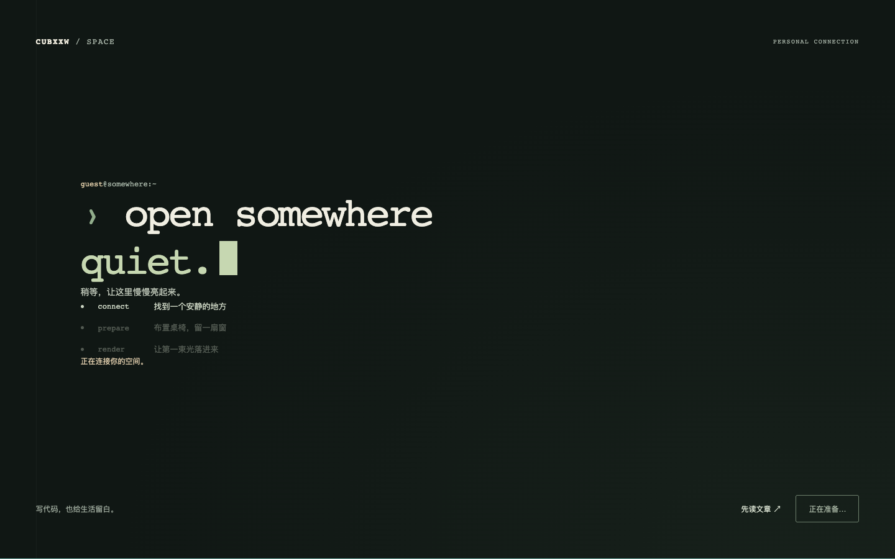
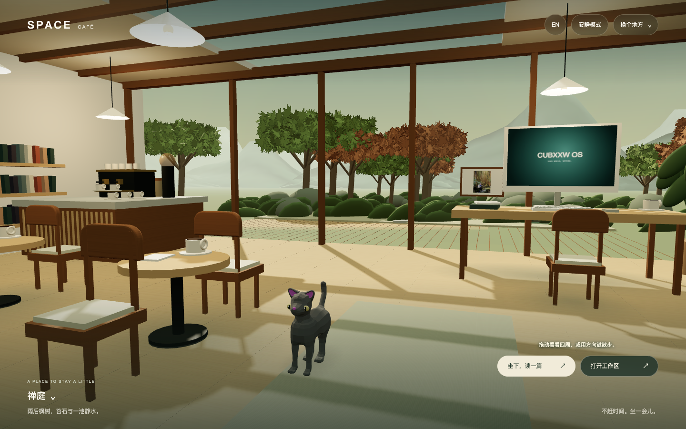
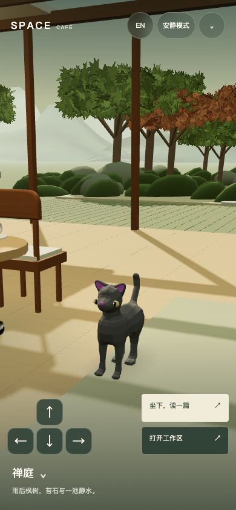

# Space 终端 Onboarding 与生活感咖啡馆：本地验收

日期：2026-10-15，Asia/Shanghai。基线：`61af6b26cae73d57190bfbe46504a6a253e6cae9`。状态：本地实现与定向验收完成，尚未部署。

普通 Space 入口现在先显示终端，同时准备真实三维房间。首帧绘制成功后才交接到咖啡馆室内；一只带骨骼的小猫自主慢走、观察和停留。读文章、打开工作区、换景、去露台与回到座位都有直接入口。

## 设计标准与实际结果

| 标准 | 已实现、已检查的行为 | 不应据此宣称的结论 |
| --- | --- | --- |
| 入口可信 | 模块、房间、首帧是实际里程碑；就绪前不能跳入黑屏；首访最短展示与渲染并行，回访与减少动态效果不额外等待 | 不使用虚构加载百分比；未测生产网络 Core Web Vitals |
| 意图连续 | 根入口刷新回咖啡馆；语言保留所在模式；明确内容目标和 Product Lab 保留；返回咖啡馆清理旧 About URL | 原有私人数据仍是浏览器本地保存，不是云同步 |
| 空间可信 | 室内起始构图，木纹、低对比地板接缝、编织地毯、陶杯、接触影、自然光、桌上真实旅行照片 | 保留风格化几何与现有六种景观，未达到照片级写实 |
| 有生命但可安静 | 本地授权骨骼猫；速度、转向、抵达缓动、绕家具与椅腿的路径、变化停留；步态随距离推进 | 没有新增喂养、跳跃、睡眠或宠物 AI 对话 |
| 阅读可用 | 一键打开文章目录/工作区；保留原笔记 DOM 和助手会话；静止电脑停止 GPU 重绘 | AI 后端真实网络调用未在本轮验收；会话专项使用明确的模型响应桩 |
| 手机可用 | 390×844、320×740、568×320 实际截图检查；主按钮实际命中范围至少44×44；窄屏猫与按钮分开构图 | Chromium 触控模拟不是实体手机、Safari 或 Firefox 验收 |
| 故障能继续 | 模块失败、可选猫失败、首帧前后/揭幕中 context loss 均有出口；原编辑器、选择区间与继续输入保持 | 没有以加载超时伪装成功 |

“99分”没有被当成可自行宣布的客观结果。功能、状态和生命周期由测试证明；审美、长期舒适度、真实设备帧时间仍需实际用户与设备验证。

## 实拍

320px 窄屏与568×320横屏另见同目录 `room-narrow.png`、`room-landscape.png`。截图来自实际运行的生产 minify 构建，不是设计稿。

## 验证回执

证据目录：`docs/acceptance/assets/space-onboarding-2026-10-15/`。

| 验证 | 结果 | 回执 |
| --- | --- | --- |
| `npm run bear:test` | 185/185通过，包括新增真实控制器计时器、猫路径与引导状态测试 | `unit-tests.log` |
| `npm run typecheck` | 通过 | `typecheck.log` |
| `hugo --minify` | 通过，双语生成 | `hugo-build.log` |
| Space café + onboarding E2E | 28/28通过，桌面与手机各14 | `browser-tests.log` |
| 环境帧调度微调后定向回归 | 4/4通过，安静/弹窗/减少动态效果/工作区暂停与隐藏Lab返回 | `frame-regression-tests.log` |
| 既有三维世界专项 | 10/10通过：走动、观察、六景、真实DOM屏幕、笔记、语言、刷新、触控、故障与连续镜头 | `world-tests.log` |
| 生命周期与键盘专项 | 4/4通过：隐藏Lab、助手输入、GPU闲置/唤醒、正文滚动 | `world-regression-tests.log` |
| 助手会话专项 | 6/6通过：迁移、上下文、新旧会话、草稿、导出、语言与窄屏 | `session-tests.log` |
| 四种尺寸真实画面与命中区域 | 通过，无页面JS异常 | `rendered-checks.json`、`rendered-tests.log` |
| `git diff --check` | 通过 | 最终源码检查 |

本机最后一次1.8秒桌面静止环境采样为30fps；这是该Mac、该次采样的观察值，房间闲置限帧约30，不能外推实体手机或生产性能。阅读模式闲置帧数不增加；换景/移动按需唤醒。修正了显示器刷新时间轻微抖动导致闲置绘制意外下降到约22fps的问题。

本地共享依赖安装落后于锁文件：TypeScript旧版不识别 `--ignoreConfig`，DSH包缺失导致3项旧测试失败；未改动主线复现后，在任务worktree使用隔离的锁定依赖覆盖修复。最终185项全部通过，未削弱断言、未更改锁文件或共享node_modules。

## 独立审查与修复

独立 reviewer 已关闭所有确认问题，并复核最后的 Product Lab 返回焦点逻辑。修复包含：

1. 工作区→露台/座位→工作区的模式一致，原笔记节点保持。
2. 取消“读一篇”转场后，迟到结果不能打开阅读器或抢走重播意图。
3. 首帧后失败不产生持续5ms计时器；揭幕中失败不留下透明活动终端。
4. 图形上下文丢失恢复普通工作区，并恢复原编辑器及选择范围。
5. history 中明确内容目标优先于旧咖啡模式；普通根入口刷新遵守咖啡默认。
6. 隐藏 Product Lab 返回时等待真实工作区就绪；用户已聚焦其他输入控件时不抢焦点。

## 运行与交付边界

源码包括新增 `onboarding` 控制器、纯行为 `cat-state.mjs`、Three.js 猫呈现模块、本地GLB与对应r160加载器。原GLB不变，新增眼睛、骨骼步态、粗糙度与场景归一化均在运行时完成。作者与CC BY 3.0授权链接显示在场景选择器；完整来源和修改记录位于 `static/models/space/CAT-ASSET.md`。

可复现入口：`scripts/space-onboarding.browser.mjs`、`scripts/space-world.browser.mjs`、`scripts/space-world-regression.browser.mjs`、`scripts/space-sessions.browser.mjs`，均可指向已有本地服务器；截图目录可通过对应环境变量指定。常规Playwright命令可只选择 `space-cafe.spec.ts` 和 `space-onboarding.spec.ts`，串行运行，复用已构建产物。

本轮未部署、未改生产环境、未调用真实模型账户。未启动iOS模拟器。正式证据保存在本项目与当前任务永久目录；可重建临时测试目录在保留本地预览后精确清理。
