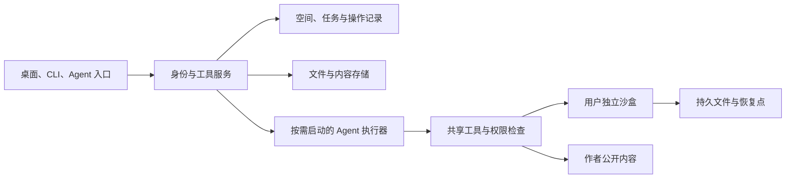

# BEAR OS：从个人博客到个人工作区

这版已经实现一个可保存、可交互的个人桌面，并连接本地真实 Linux 沙盒。公开网站仍由 Hugo 构建；访客工作区保存自己的布局和笔记。未来的登录、云端沙盒和长期 Agent 沿这套边界接入。

## 走进空间之后

首屏直接打开欢迎窗口和熊野古道照片。访客可以先了解作者，也可以自己安排桌面。山水壁纸、公开旅途照片和暖色应用图标构成空间的视觉身份；窗口承载真实内容。

桌面支持多个应用同时打开、移动、缩放、边缘吸附、并排、最小化、最大化和恢复。Dock 保留运行标记，窗口概览帮助找回被遮挡的应用。搜索同时查应用和文章；手机改用全屏应用与横向 Dock。

一个可实际体验的过程是：打开产品，进入相关写作，收藏文章；打开旅途照片，再进入对应地图区域；写一段自己的笔记，刷新后继续，或者导出文件。在本地连接沙盒后，还可以把笔记写入 `/workspace/note.md`，通过终端读回。

`/projects/` 与 `/zh/projects/` 默认打开 BEAR OS，Product Lab 保留双向切换。文章原始路由、现有首页和 About 页继续可访问，OS 阅读器也提供原文入口。

## 这次实现的范围

| 入口 | 实际行为 | 当前边界 |
| --- | --- | --- |
| 关于我、社交 | 仓库身份信息与真实渠道 | 未代访客发送消息 |
| 产品 | 真实截图、预览、源码和相关写作 | 预览打开产品自己的链接 |
| 文章 | 搜索、站内正文、收藏、原文 | 阅读器不执行文章脚本，交互文章应打开原文 |
| 相册、地图 | 8 张公开旅行照片、3 个区域，彼此打开 | 区域中心代表旅行区域；不是照片 GPS；Immich 未接入 |
| 书架 | 4 本仓库标记为作者作品的书，连接原有阅读入口 | 界面封面采用文字设计 |
| 笔记、留言 | 本地保存、Markdown 导出、留言草稿、真实联系渠道 | 没有云端留言板，也没有模拟送达 |
| AI 向导 | 现有 blog-ai 流式回答；精确打开和运行指令调用共享操作 | 尚无自主多步规划、后台任务与长期记忆 |
| 终端 | 桌面命令与实际 `run` 沙盒命令 | Linux 执行目前仅本地开发可用 |
| 设置 | 浅深色、壁纸、导出、连接状态 | 访客登录、跨设备同步尚未接入 |

桌面、CLI 和 AI 的精确操作共享 `execute(name, args)`。`window.BearSpace` 暴露版本、工具说明、操作入口和状态快照，方便继续适配 Agent。它目前是浏览器内接口；还不是远程 MCP 服务。

自然语言问答复用现有 blog-ai。浏览器中实际询问“用一句话介绍熊鑫伟。”，收到真实流式模型回复，并显示完成状态。自由提问不会自动变成宿主电脑操作。

## 有状态，以及如何长期运行

应该长期保存的是用户空间、文件、笔记、收藏、任务记录和恢复点。Agent 执行进程可以重启；沙盒可以在需要时启动，在闲置时暂停。不能把“保留一台电脑”理解为“永远开着一个模型循环”。

本版把两类状态分开：浏览器里的窗口、偏好、笔记和收藏采用有版本的本地存储；沙盒文件写入独立 Docker 卷。服务停止再启动后，已写入的文件仍可读回。停止容器会丢失其中的运行进程，当前实现没有内存快照。

未来云端版本按以下方式划分：



静态页面可以继续放在现有 CDN。登录和保存由可用的 API 与数据库承担，不要求自己一直开着笔记本。只有执行任务时才启动 Agent 和沙盒。第一步可用托管服务；如果以后自己运行执行器，再单独部署服务器。网页的部署方式与电脑的执行方式可以独立选择。

云端沙盒需要提供创建、连接、运行、读写、暂停、恢复和销毁的适配接口。现有 Docker 服务用于本地验证；云端候选需要另做生命周期、网络与隔离验收。例如 [E2B 的官方持久化文档](https://docs.e2b.dev/sandbox/persistence)明确区分文件快照与文件加内存快照，可作为按需电脑的接入参考。它尚未接入本项目。

## 通用化的关键

作者公开空间与访客私人空间应有不同的数据归属。产品、书籍、公开文章和挑选后的照片属于作者；访客笔记、历史、收藏、对话和沙盒属于访客。登录后必须在服务端依据身份检查空间访问权限，不能依靠浏览器传来的用户编号。

下一版的数据模型至少包含空间、成员、文件、应用状态、对话、任务、操作和授权。任务保留提交、执行、等待、完成、失败的状态与输出；进程重启后根据记录恢复，避免重新提交已执行的外部操作。

应用可以逐渐注册为独立清单：名称、图标、界面、输入输出、可用工具和权限。图形界面与 Agent 使用相同操作；工具返回实际结果和对应对象，不靠修改页面文字宣告成功。以后更换沙盒提供方，不需要重新写照片、阅读和产品应用。

Immich 应通过服务端适配。凭据留在服务端，作者选择哪些相册与位置公开。访客只能看到公开投影，不能因为打开地图便获得私人照片库权限。接入依据为 [Immich 官方 API](https://api.immich.app/)，本次没有读取私人相册。

## 本地运行与工具边界

在仓库目录分别启动两个服务：

```sh
node scripts/bear-runtime.mjs
npx netlify dev --offline --port 8889
```

Docker 需要已经运行。打开 `http://localhost:8889/zh/projects/`，设置中可看到沙盒连接状态。终端可输入：

```sh
open notes
run printf 'hello BEAR\n' > /workspace/hello.txt; cat /workspace/hello.txt
```

也可对 AI 向导输入 `run cat /workspace/hello.txt`，它调用同一个本地执行入口。此类精确指令的解析与模型自主选择工具是两种能力，目前实现前者。

运行服务只监听 `127.0.0.1:8777`，使用随机令牌；本地配置写入已忽略的 `.netlify/bear-runtime.json`，权限为 600。前端不会收到令牌。Netlify 代理仅在开发模式下接受 localhost 同源请求，生产模式明确拒绝执行。

容器采用固定 Alpine 镜像摘要，无宿主目录挂载、无宿主凭据，禁用网络，限制内存、CPU、进程数和单次命令时间。这个环境只验证个人本地执行，不作为公开多用户安全隔离方案。文件保存在 `bear-space-local-v1` 卷；退出服务停止容器，保留该卷。公开多用户版本必须另做隔离与生命周期设计。

访客笔记最多 40000 字符，留言草稿最多 6000 字符，收藏最多 200 条。笔记直接写入沙盒的入口暂限 2600 UTF-8 字节，较长内容可导出。网页本地保存与手动保存沙盒是两次独立写入，编辑后不会继续显示已经同步到沙盒。

## 对照参考站

实际打开并操作了 [Dustin Brett 的 daedalOS](https://dustinbrett.com/) 和 [Joey de Ruiter 的空间](https://joeyderuiter.me/)。本轮覆盖桌面进入、应用打开、窗口控件和终端观察；没有完成它们的移动端、所有文件操作或长期恢复测试。

daedalOS 的优势是桌面能力的广度。其 [官方 README](https://github.com/DustinBrett/daedalOS)已经列出 IndexedDB 文件系统、窗口持久化、AI 和丰富应用，不能把它描述成只有外观。Joey 的优势是进入一台复古电脑的空间感，实际终端还提供文件目录命令和管道、重定向提示。

BEAR 的设计重点是作者身份、真实产品与文章、旅行照片、私人写作和执行工具之间的连续使用。去掉入场操作让访客立即接触内容；手机采用独立布局；同一份笔记能够进入真实 Linux 工作目录。后续 Agent 应围绕这些对象做事，而不是增加一个与空间脱节的聊天框。

按本项目预先定义的个人工作区任务评分，本版设计自评 **91/100**：

| 维度 | 满分 | 本版自评 | 得分依据与扣分 |
| --- | ---: | ---: | --- |
| 首次可用 | 15 | 15 | 无开机门槛，首屏即有真实内容 |
| 窗口交互 | 20 | 19 | 多窗口、拖缩、吸附、排列、概览；尚无多实例文档窗口 |
| 内容与跨应用连续性 | 20 | 19 | 产品与文章、照片与地图、笔记与沙盒相连；缺少摘录回链 |
| 持久工作 | 20 | 17 | 刷新恢复、导出、沙盒重启保留文件；未登录同步与恢复后台任务 |
| 手机与可访问性 | 15 | 13 | 320/390 窄屏、键盘聚焦、减少动态效果；未完成读屏器全流程验收 |
| 视觉与反馈 | 10 | 8 | 原创山水与真实照片、浅深色、直接手势；空间演出感仍可进一步提升 |
| 合计 | 100 | 91 | 对本产品目标的自评，不是独立竞品基准 |

这张表不能证明全面超过两站。其未测维度保留未知，不记为零分，不给出编造的竞品总分。超越目标应由完整同场景对测和作者实际体验确认；当前能证明的是本地实现已打通上述工作流。

## 验收证据与下一步

状态、鉴权与代理测试 13 项；真实 Docker 测试 2 项；浏览器工作流 20 项。另有仓库内容输出检查器的 15 项回归测试，以及中英文产品集成检查。干净生产构建的 643 个 HTML 页面通过全站输出检查，0 错误、0 警告。截图和浏览器验收记录在 `output/playwright/bear-workspace/`。没有发布线上版本。

实际检查覆盖刷新保存、最小化恢复、移动缩放、键盘焦点、正文链接、加载中返回目录、照片地图、文件导出、深色标题、减少动态效果、320/390 窄屏、双向视图、真实沙盒命令和 AI 共享执行入口。故障测试也验证 AI 不可用和取消、损坏状态、越界窗口、无令牌请求、生产环境拒绝和并发执行冲突。

下一步先接访客身份和跨设备数据，再提供每个访客的云端沙盒与工具授权，最后加入可恢复的 Agent 任务。Immich 的公开照片投影和真正留言板可独立接入。只有这些服务验收后，才能把空间称为可长期代用户管理的个人 Agent 电脑。
