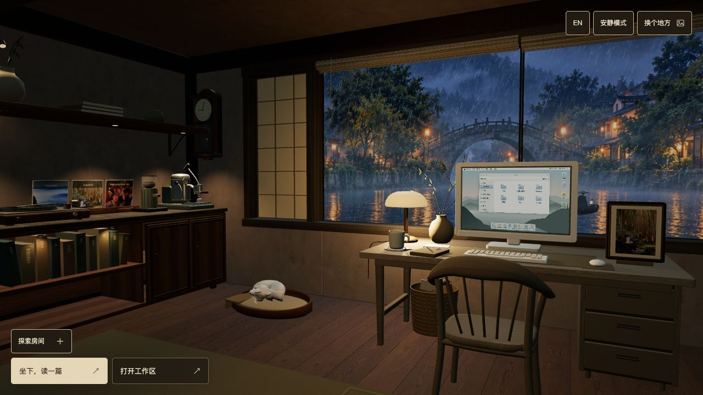
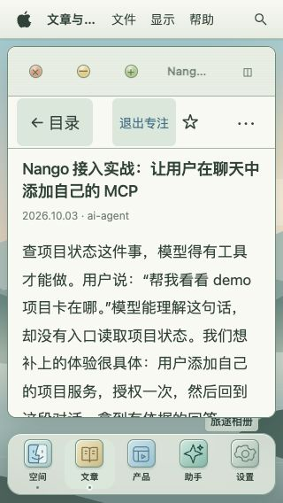
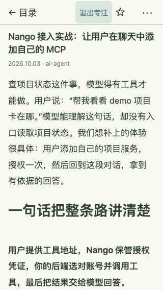
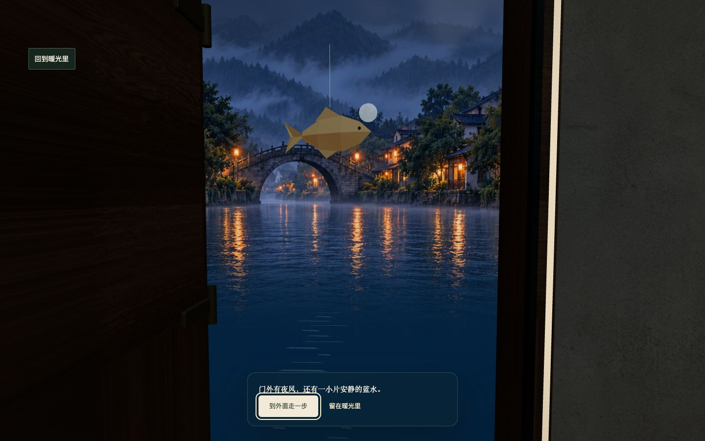
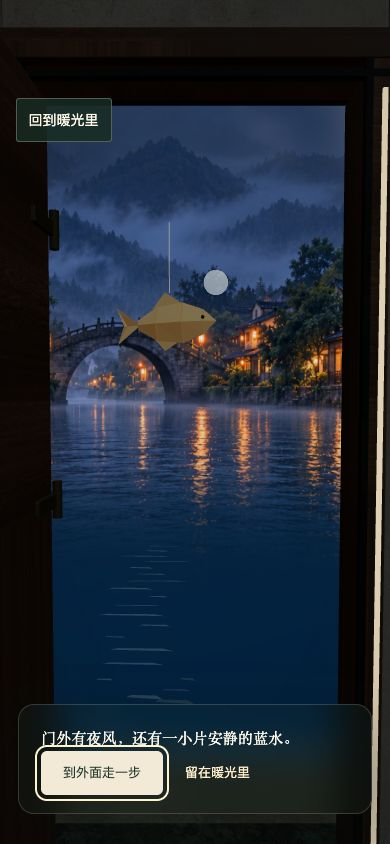
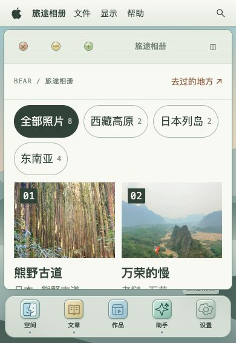
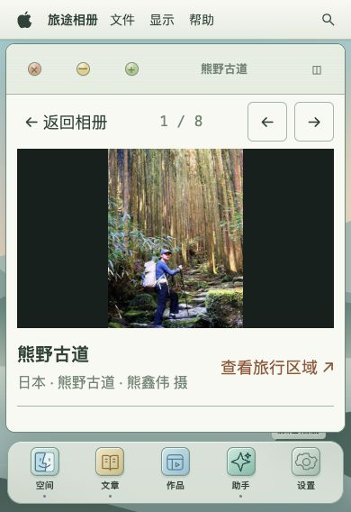

# Space 感官与连续使用细化（2026-10-23）

本轮在江南咖啡馆与 BEAR OS 原有结构上改进阅读、媒体、导航、音频视角和后门彩蛋。主 agent 逐轮检查真实界面、提出细节问题，worker 分模块实施，独立 reviewer 复核。代码在隔离工作树完成，不改文章内容。

## 已实现

| 区域 | 具体变化 | 目的 |
| --- | --- | --- |
| 房间入口 | 阅读、进入工作区两个清楚的入口；说明折叠；辅助按钮降低边框对比；保留清楚的焦点环与触屏区域 | 让房间先成为空间，操作保持可发现 |
| 电脑与阅读 | 默认展开；小屏单活动窗口；真正的全屏专注阅读；正文约 74ch；工具折叠到更多菜单；隐藏裸露标题锚点 | 给正文留出实际阅读高度 |
| 阅读连续性 | 原 DOM、滚动与选区保持；选区工具只使用当前仍有效的正文选区；Escape 逐层退出 | 防止解释了旧段落或切换后丢位置 |
| 我的空间 | 真实最近文章、轻量全部应用入口、可访问的搜索图标、统一的作品标签 | 让首次打开就有可做的事情 |
| 笔记与设置 | 简短 17px 占位语；浏览器真实保存结果与导出反馈；沙盒功能移入次级入口，惰性连接并在执行前再次检查；设置优先显示用户能控制的选项 | 避免把开发环境能力当成产品承诺 |
| 相册与地图 | 手机筛选可换行；详情按真实窗口高度容纳图片；返回恢复筛选/滚动/原焦点；地图控件移到图下；地区故事直接可见 | 减少遮挡和找不到内容的问题 |
| 助手 | 紧凑窗口使用可用区域；触屏发送按钮至少 44px；可展开来源与引文，旧草稿缺原文时明确提示；空态提供真实文章入口；预设明确点击即提问；回答中的本地文章可直接打开，路径按真实目录白名单验证 | 从结果继续阅读，同时保留安全边界 |
| 音频视角 | 门边与入水时分别平滑改变音乐/雨声增益，返回恢复；用户音量、静音、曲目和播放位置不变 | 让空间位移影响听感而不违背播放意图 |
| 灯光 | 实际初始强度参与渐变；切灯连续，最后一帧刷新阴影；静止模式立即收敛 | 避免首轮关灯跳变或旧阴影残留 |
| 后门彩蛋 | 墙体真实开洞、木门/黄铜把手/门缝暖光/石台与冷色水面；开门后还要主动迈一步才落水；水花与可随时返回的入口 | 加入可重复的小意外，保证返回原来的空间 |

## 后门与恢复边界

流程为 `indoor → approaching → opening → threshold → falling → submerged → returning → indoor`。门槛处可选择留下；落水后可点击返回，移动过程中的返回入口和 Escape 也有效。手机入口不依赖 hover。减少动效时保持相同选择，取消动效过渡。

修复并复核了中断复用旧异步 token、后台计时、切换静止模式、销毁后的迟到 UI、开门时进入助手工作区返回旧相机等问题。返回恢复门前位置与 inspection，原笔记 DOM、逆向选区及正文滚动有真实交互用例。普通走动边界保持室内，特殊落水路线只穿过实际门洞。

## 实际界面证据

以下是本轮内置浏览器的真实截图，不是生成效果图。房间截图为第一轮；手机阅读截图为第三轮改进后。最终 C 方案、短屏相册、助手历史和兼容场景地图已由 main 使用真实内置浏览器复核；完整 CI 仍单独记录。

| 手机阅读第一轮 | 手机阅读第三轮 |
| --- | --- |
|  |  |

已在实际界面验证：320px 全屏专注阅读、真实正文选区及更多菜单、Escape 分层退出、768px 助手与返回正文、首页文章导航、笔记多行导出。导出文件逐字一致（合成测试文本，64 UTF-8 字节）。静态独立视觉评分：手机专注阅读从 79 提升到 91；这不是总体 99 分，也不代表动态或声音已验收。

## C 方案与真实边界复核

作者选中 C：木门、纸鱼、月亮、克制的冷暖水面反光。纸鱼是 44cm 折纸实体，月亮有静态明暗与柔和边缘。艺术组 8 次主绘制，没有新增纹理、计时器或持续唤醒。后向摄影映射重用现有夜景，前向角度映射保留；前景水面顶点 alpha 渐隐，消除水面有限边界的硬切线。超出摄影板的上方及两侧向天空渐隐，避免仰视时拉伸边缘。门槛视角在手机后退，窗口旋转会重新取景；落水回望也保留清楚的返回入口。

| 390px 门槛 | 390×568 相册 | 390×568 照片详情 |
| --- | --- | --- |
|  |  |  |

main 的实际浏览器读回（本地最终源码，非生产验收）：

- 390×568：图库可用照片区域 181px；详情照片高 199px；详情三个导航按钮均 44px；筛选、说明、来源及返回保留。
- 768px：会话历史关闭按钮 54×44px，中心命中。真实截图：`final-assistant-history-768.jpg`。
- 620px 禅庭：地图放大按钮实际 44.28×44.28px，中心命中且点击有效。真实截图：`final-map-zen-620.jpg`。Jiangnan 的可选 framed 视图为任意缩放，不能据此推断所有 framed 尺寸均达到 44px。
- 320px：专注阅读未滚动的进入/退出从 scrollTop 0 精确回到 0；四项提取真实生产函数的动态测试还覆盖底部夹断、用户滚动、正文替换与重排。滚动中的人工即时量测未当作锚点不变证明。
- 正常动态与减少动效的开门、主动迈步、落水、返回均实际操作；后门返回按钮颜色与深底样式已读回，避免被全局 button reset 覆盖。旋转到桌面/手机时门槛 pose 正确重算。
- Chrome 真实正常动态小猫从 `waking` 到 `arrived`，相机保持；真实音响播放时音量 End 到 100%，曲目与滑杆焦点不变，随后恢复 60% 并暂停。未做人工听音。
- WebGL 日志复核未观察到 shader 编译错误；这不代表所有 GPU/浏览器已覆盖。

## 合并队列

作者要求一并解决并合并当前仓库其他 PR。采用 #472 承载最终整合验收，保留 #463、#466、#467、#473、#474、#475 原 head 的 merge 祖先关系；通过后使用 merge commit 入 main，读回每个 PR 的状态。没有把旧失败检查视为通过。

- #463：SEO analyze 的真实边界证据冻结在 action 1.0.240，保留该 pin；SEO fix 可升级 1.0.254，不改写旧证明。相关 70 项检查通过。
- #466/#467/#473：合并 markdown-it 15.0.3、follow-redirects 1.16.1 及工具链更新；工具链配置同步 Playwright 1.64.1、Netlify 27.13.0。npm 10.9.4 发现旧 Netlify 子树错误沿用，重建其 nested lock 图后，1,530 个节点所有依赖边错误为 0，官方 tarball/integrity 独立复核通过，真实 clean npm ci 成功。
- #474：仅在解析/追加成功后缓存分页 URL；两个真实 DOM 重试回归通过，纳入 ux:test。
- #475：恢复既有首页双栏介绍/对话、社交入口与文章卡片；保留当前 Space、字体、直达产品链接与聊天安全。独立源码审查通过，最终整合 CI 与生产验收仍必需。原作者本地/预览证据见 `docs/daily-quality/2026-10-23-home-layout.md`。main 在整合树使用 Chrome 复核中文 1440/375px，聊天打开/关闭后焦点回到入口，375px 页面宽度未溢出。

小猫在低帧率下的用户互动改用仍受 2 秒/40ms 子步上限约束的可见时间，普通例行与呼吸时间不变。唱盘目标移到实际盘面，避免浅射线误选背后唱片；真实 Three 几何回归先复现旧目标失败后通过。两项中途相机测试使用官方帧时钟控制，避免软件 GPU 中输入协议返回耗时大于整个相机移动，仍保留中间位移、反转、速度与节点断言。

## 验证记录与交付门禁

- 水幕增量前新依赖阶段 `bear:test`：513/513（历史检查点） 通过，0 跳过（后续水面/回望增量另有定向验证，与总组重合，不相加）。
- `ux:test`：58/58 通过，含 #474 两项回归。
- TypeScript 7.0.2 主配置及 interactive 配置通过；diff check 通过。
- 后门/摄影生命周期最后定向组：45/45 通过。艺术、媒体、阅读与 lock 独立 review 未发现尚未关闭的已确认 P0/P1/P2。
- quality:test 首跑因 Hugo 未在 PATH，12 项失败；voice:test 同一原因 1 项失败。使用已安装的 pinned Hugo 0.145.0 修正测试环境后只重跑受影响组，受影响组重跑 27 通过、1 项既有条件跳过，0 失败。未修改测试以掩盖缺失二进制。
- 首轮远程 run `39823444301`：生产构建、645 个输出文件审计与 48 项 quality 浏览器检查通过；完整 legacy 被 120 分钟 job 上限取消。9 项新增后门 E2E 在 desktop project 通过，但不代表 mobile project 已执行。先前失败根因逐项处理后必须完整重跑。
- 完整 desktop/mobile 矩阵保留；起初将串行 job 预算调整为 240 分钟。随后 #475 更新将同一份冻结生产产物交给 quality、四个 legacy 分区和三个 interactive 引擎并行验收，每个 runner 仍只有一个 worker，每个 job 120 分钟。最终门禁必须收到全部成功且身份匹配的结果，才创建可发布 manifest；没有移除强制检查、减少重试或用旧提交绿灯替代最终 head。
- 最后独审补回动画测试的移动完成断言，并修复 approach/opening 中旋转后仍使用旧 aspect 的门槛取景；真实生产函数的两时窗回归所在组 8/8 通过，两个 P2 已独立复核关闭。
- 远程审查再确认一个中断边界：开门途中直接进入 expanded 工作区会暂停环境时间，实际门叶可能停在 openAmount=0.245。仅在显式中断故事时立即合门并清水花，正常返回仍有关闭动画，没有新增后台帧循环。真实 Three 门和生产 focus/abandon 函数覆盖 opening、threshold、submerged 三个时窗；修复前失败、修复后门组 32/32 与 TypeScript 7 通过。
- 新 run 日志读回实际宿主已是 Ubuntu 26.04.1，浏览器依赖安装 13 分钟仍在下载 142MB/185 个新包。prepare、browser 与 verify 统一固定 `ubuntu-24.04`，保留三个引擎和全部检查；这是 [GitHub 的明确镜像标签](https://github.com/actions/runner-images#available-images)，本地 Playwright 1.64.1 也声明支持此平台。该固定减少环境漂移，不保证网络速度，仍需实际 CI 验收。
- run `39901477096` 的 production/offline、quality 48/48、三个 interactive 引擎各 191/191 以及两个 legacy 分区通过，但手机网页保活旅程的 native/compatible 均在三次尝试中超时，整轮取消，最终门禁正确拒绝发布。两份 trace 显示输入确实改变镜头：compatible 超时仍在风扇瞄准，native 已切换灯和风扇、在书架瞄准时超时；完成的 100px、六次插值小拖动各耗时约 6.3–9.6 秒，均尚未走到网页和音源身份的返回断言。依据该证据优化物理瞄准辅助函数：使用视口安全边缘间的一次真实拖动，继续重投影与实际点击；原 90 秒、10 轮上限、旅程断言和专项多步触屏测试全部保留。修复仍以新的完整 CI 为准。
- 音频状态/包络及实际音源身份由测试验证；没有人工实听，不能宣称声学质量或整体 99 分验收。
- run `39906990684`：原手机 native/compatible 网页保活旅程首次分别在 37.3/40.0 秒通过，原 90 秒预算不变；桌面两条也首次通过。三个 interactive 引擎各 191/191、quality 48/48、两个 legacy 分区通过。但后续桌面 1440px 普通动效的水层在已进入 submerged 后 opacity 连续 5 秒仍为 0，三次重试均失败；该轮取消，最终门禁拒绝发布。新增只读动画/CSS/时间状态取证，并在同一冻结产物上先执行原失败旅程；原断言、150 秒预算、重试、后续 8 分区和汇总门禁保留。带诊断通过也不能据此宣称根因已修复。

最新 #475 原 head `5e8c0e89` 已整合：呼吸另收完整可见时间，普通移动和用户互动仍分别保留原有安全时钟；真实骨骼的 60/1/0.7Hz 回归使用实际 capped-delta/raw-breathing 组合。原两条多物件、同网页旅程及单次物理瞄准保留；独立相机测试仍验证中途状态、结束状态与原镜头速度阈值。定向 Node 32/32、TypeScript 和独审通过，完整远端验收另行绑定最新 head。

旧 `21d3503b` 运行另有一次搜索输入框失焦后重试通过，具体事件因果未被该 trace 捕获。单独检查发现可确定复现的关闭/重开边界：[原生 dialog 的 close 事件会排队](https://html.spec.whatwg.org/multipage/interactive-elements.html#close-the-dialog)，迟到的旧事件会消费新一次打开的焦点记录并 blur 新输入框。生产 listener 在任何读取/删除/blur 前忽略已重新打开的 dialog。直接执行实际生产 listener 的新回归修复前 4 过/1 失败；修复后连原 entry 组 15/15 通过，同时确认随后真正关闭仍恢复新一轮 trigger、restore=false、隐藏工作区和菜单备用焦点行为。新回归已接入强制 BEAR 命令；没有延长焦点断言或改变真实浏览器步骤，也不将这个可证实竞态等同于旧 CI 偶发失焦的已证根因。

`c877a62d` 的串行后门旅程再次三次失败；只读取证显示，在 document timeline 前进约 4–5 秒且房间继续渲染时，水层 CSSTransition 仍为 pending、currentTime=0、startTime=null，选择器与 submerged 状态正确。针对尚未启动的过渡，仅在 excursion 期间提前声明该水层 will-change:opacity，保留 opacity 0/1、480ms 和原交互；它会暂时增加一张全屏合成层，返回 roam 后撤销。此为待验证的最小图层准备修复，浏览器/合成器具体原因仍未证明。串行 preflight 增加三次独立重复，原重试、预算、断言、后续完整矩阵不变；只有三次均首次通过、完整门禁和真实普通动效验收通过才能接受。

图层准备实验 `83488195` 的首轮与后续重试仍出现相同失败，已判定无效并撤回 will-change。下一隔离实验让人审截图使用 animations:allow，避免采集主动 finish/cancel 动画；这些附件不是像素基线，仍需按原 5 秒、150 秒、三次独立重复与完整矩阵验收。截图依然有布局/绘制与时间成本，因此即使通过，也不单独证明旧失败的浏览器内部根因。

最新远程 PR475 head `3401e583` 的真实小猫输入观察和已有音频冷启动预算对齐、PR463 head `52c3f18d` 的 fix Action v1.0.255 均已独审整合；analyze 保留 v1.0.240 及原 SDK/CLI 证明，未将旧证明套用于新版。三组 SEO 定向测试 120/120、TypeScript 和 diff 检查通过。

## 水幕最终实现与验收边界

`8d959892` 的截图观察实验同样失败：三次独立重复、每次三次尝试，共 9/9 次 opacity 断言失败。submerged、选择器和可见性正确，document timeline 前进约 4.5–5.35 秒，水层 CSSTransition 却仍 pending、currentTime=0、startTime=null。已否决截图选项和 will-change 作为修复；没有据此推断 Chromium 内部具体根因，也未放宽原 5 秒视觉断言。

水幕改由已有场景帧更新显示值，保持原 480ms 和 CSS ease 曲线、精确 0/1 端点与连续反向。静止/减少动效立即收敛，显式进入工作区同步清空，后台与弹窗遮挡期间不累计时间，销毁撤销未完成的显示。仅有待完成渐变时延续已有 RAF；没有额外计时器或独立循环。CSS 保留静态默认值，取消与帧更新竞争的 opacity transition。

最新 #475 head `ede1552b` 已独审整合：记录真实首个 respond/pet/petting 模型响应，原生 Enter、到达预算、动作断言及原两条同网页多物件旅程保持不变。这个测试只证明实际响应已发布，不代表人工观感或听音验收。

水幕独审发现的遮挡时长误计入问题已修复：仅水幕自身记录 unblock 时间，遮挡 750ms 后恢复 10ms 仍保留未完成的水幕；同一真实 tick 的返回镜头仍累计 770ms，未更改镜头或小猫时钟。水幕阶段本机 `bear:test` 539/539 通过，0 跳过；初跑 7 项旧 tick 夹具缺少新 controller 的失败原样留档，补充真实 controller 依赖后原断言全部保留。两个 TypeScript 配置和 diff 检查通过，产品及夹具独审无尚未关闭的已确认 P0/P1/P2。

另修复 PR 审查指出的首次通过门禁缺口：串行 preflight 使用 `--repeat-each=3 --retries=0`，任何一次首次失败都令 prepare 失败，不能重试转绿；原 150 秒旅程、5 秒 opacity 断言与后续完整矩阵保持。工作流回归直接执行该内联程序，替换进程/文件系统边界，验证实际参数、冻结证明前后校验及成功/失败/未知退出码。该组 8/8 通过，独立审查通过。这是对“三次均首次通过”要求的收紧，不将先前 retries=2 的失败运行算作通过。

最终 CI、远程 merge、部署版本、线上验收与资源收尾将在明确后记录。当前报告不等于已上线。

## 完整 CI 后的滚动与经典房间媒体修复

`65126e9c` 的水幕 preflight 三次首次通过（49.4/47.0/47.5 秒）；quality 48、三个 interactive 引擎各 191、legacy 1/3 各 270 项通过。legacy 2/4 各有相同五个失败，因此整轮未通过，发布合法跳过，未据此合并。五项为同一阅读器滚动连续性问题，以及手机媒体字号、图库空间、错误的按钮整数高度约束。

独立复用原冻结产物运行原阅读器用例，原 DOM、笔记、反向选区与文章身份均保持，但滚动差仍为 700。Trace 最后 700 出现在转头 mouseMove 后，150ms 后同一次原生手势的 mouseUp 快照里，monitor 首次 display:none 且 getter 为 0，后门尚未点击；返回可见桌面后仍为 0。隐藏时 getter 为 0 本身不证明永久偏移丢失的内部时刻，返回后不恢复才是可验证缺陷。修复在离开可交互桌面前保存真实 owner 的横纵位置，monitor 不覆盖快照，在同一 DOM 恢复布局和焦点后回写；新文章/已关闭节点跳过，dispose 释放。五项生产 attachment/生命周期回归通过，独立审查无已确认 P0/P1/P2；原 E2E、选区和滚动断言及预算不变。

在真实 651 预览的 390×568 经典禅庭复现图库可用区域 95.94px：372 个逻辑像素的窗口正文投影后为 305.04px，筛选占三行、实际高 159.08px。经典房间固定 .82 投影，手机专用覆盖把 kicker 11px 缩为实际 9.02px。补偿只作用于六个经典投影房间：14px kicker、18px 操作文字、54px 逻辑目标、两列紧凑筛选；照片设 220px 逻辑下限，保护投影后 180px 阅读高度。江南原尺寸桌面、Cinematic 与无 WebGL fallback 不套该补偿。图库 150px、照片 180px、可读字体下限和中心命中继续保持；两处原 toBe(44) 改为实际高度至少 44，容纳正确的 54×.82=44.28，不把正确小数目标判作失败。

最新 main 已包含单独验证上线的 #475；其发布记录与 Space C 尚未完成的整合状态分别保留。新 #476 原 head 22f933fd 除 DOMPurify 3.4.16→3.4.17 外误删 19 条 peer lock 节点，原 CI npm ci 失败。保留原 head 的 merge 祖先关系，仅采升级所需 version/resolved/integrity 三字段，完整 1,530 节点图保持。此 root dev 依赖更新不会替换生产单独 vendored 的 Mermaid/DOMPurify，不能宣称生产消毒器随之升级。

本机定向 host 20/20、完整 BEAR 544/544、主与 interactive TypeScript 配置通过；最终修复的浏览器尺寸、原阅读旅程、clean npm ci、完整远程门禁与生产验收仍需新 head 的实际结果。

## 审查补充：桌面中断后的返回语义

自动审查指出门外故事被工作区捷径打断时，coffee/books/clock 会误保留特写，而普通 focus/leave 应返回原行走位置与 roam；window 则继续保留独立检查视角。新增生产函数回归先复现错误，再让两条入口共用既有返回规则；五类初始状态逐一覆盖 approaching/opening/threshold/falling/submerged/returning 六阶段，并验证迟到故事任务不反改目的地。相关 41/41 通过，完整 BEAR 549/549、两个 TypeScript 配置与 diff 检查通过；最终远程验收仍绑定新提交。

测试使用的 acorn8.19.0、jsdom22.1.0 由原锁图中的间接依赖改为显式固定开发依赖。只新增 package.json 与 lock 根声明，没有改变任何已锁包版本或执行本机安装；新的真实 clean npm ci 由完整 CI 负责。旧文档513、539均明确标注历史阶段，当前549不与旧组相加。
