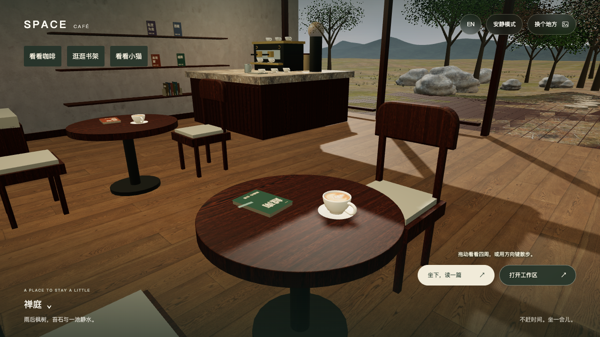

# 咖啡馆整体材质、场景与猫互动

基线 `75e82d56`；唯一源码分支 `codex/blog-experience-20261016`。这是中午审计后的新一轮人类反馈实现；旧 `12-00` heartbeat 保持暂停。预览：<http://127.0.0.1:1317/zh/projects/>。未推送、未部署。

## 交付范围

- 室内：真实木材／灰泥 PBR 通道、以米为尺度的投影、窗框与墙脚结构、不同在读书／书签／铅笔、吧台布巾／奶缸、猫水碗；保留原作者书目、照片、拉花与终端入口。
- 室外：连续地表、苔石落地、四种非对称平滑岩体、三平面岩石材质、摄影松针、远山体量与距离雾、曲岸与水面法线。背景天空与各场景环境反射独立，不把近景 HDR 当巨幅墙纸。
- 猫：`看看小猫` → `叫猫过来`／`摸摸猫`，实际模型命中与键盘入口共用动作；普通动效模式有限走近／眯眼／抬头／尾部回应，减少动态及安静模式给即时静态回应。保留原 GLB 与授权，仍是风格化模型，不能称写实毛发。
- 园林：灰泥厚墙／石基／顶压／月洞拱圈，竹节、分枝和成簇薄叶。雨街：真实窗洞、返墙、窗框、窗台、后退的暖窗室内和屋檐；原太阳夜间关闭，以弱冷环境与原吊灯暖光照明，日景精确恢复。G 修复园墙、街屋与铺面基础悬空，并衔接退进立面的台阶。

## 实拍与纠错链

原始截图保留完整像素，没有后期美化。`before-room-1440.png`／`before-room-390.png` 是旧环境；`invalid-viewport-before-room.png` 是视口错配的无效捕获，明确排除验收。

| 候选 | 实际发现 | 处置 |
|---|---|---|
| A | 猫眼贴附缩放放大、耳尖裁切 | A1 保留骨骼缩放、按实际包围盒构图 |
| A1 | 眼睛在鼻子下方 | A2 从实际蒙皮头部定位鼻尖，修正眼线 |
| B | 户外松树裸、重复碎石、平面山、水岸与水纹不自然 | C 连续地表、摄影枝叶、山体与曲岸 |
| C1 | 踏石离新地面数厘米、摄影 HDR 如糊墙、山 UV 条带、岸网格阶梯 | C1 接地采样；C2 天空与反射分离、连续投影／岸顶点 |
| C2 | 山高近、松树发黑／白枝、水面银带、岩体折面明显 | D 后退降山与距离雾、薄叶受光、细分平滑岩、水材质校准 |
| D | 平滑岩暴露 dominant UV 轴切换宽带 | E 片元三平面混合；`e-zen-1440.png` 同机位宽带消失 |
| E | 六景检查发现园林纸板墙／裸竹、雨街盒体窗、夜间仍有强日光影 | F 定向修正；完整园林、竹侧、雨街、雨室内与白天恢复实拍 |
| F | 独立几何审发现园墙及雨街基础／铺面有数厘米到十余厘米间隙 | G 按实际三角地面脚印最低支撑下嵌，并补退进铺面；独立 Raycaster 足迹断言与最终实拍复核 |

`actual-acceptance.json` 为 A2／C2 动作原始记录，`e-acceptance.json` 为 E 六景、手机、中英、连续性及故障注入记录。每份记录只代表其版本；文件名中的旧 `final-*` 是 C2 当时的候选，后来已被人眼否决，不能用作最终接受证据。

最终版本为 **G**。`g-acceptance.json` 记录最终六景、手机实体命中、原窗口容器连续性与浏览器恢复；`g-*.png` 共 15 张，覆盖六景露台、桌面／手机整室、工作桌、杯、书架、手机猫互动、手机园林／雨街及用户正常视口。`f-rain-room-1440.png` 与 `f-day-restored-1440.png` 记录未再改动的昼夜光照行为，不能拿露台图片代替夜间室内。

## 最终验证

- G 冻结源码完整执行 10 个相关 Node 测试文件，**63 个不同测试全部通过，0 失败／跳过**；日志 `final-g-node.log`。不累计 A–F 各版本重复次数。
- 最终 Hugo `--minify` 构建成功（`environment-g-hugo.log`，5929ms）；TypeScript、JS 语法、内存模块链接及 diff 检查通过。旧全站 E2E 未重跑，不声称所有博客按钮重新验收。
- 独立 reviewer 复核 G 的实际三角片脚印裁剪、基础不变的顶标高、退进铺面衔接与独立 Raycaster 断言，结合实际图关闭 F 接地缺陷；其它已确认源码 P0／P1／P2 无遗留。整体审美判断及未覆盖项仍按八门槛保留。
- 测试原始日志含首次失败记录已压缩保存在 `validation-logs.tar.gz`，82 个日志／诊断共 2,053,679 原始字节，逐件解压回读 SHA256 一致，详见 `validation-log-manifest.json`。没有用最后一次 PASS 覆盖失败历史。

## 已有实际验证与范围

1. A2 普通模式实际呼唤出现 approaching → arrived；抚摸 petting → quiet 后 petted-still，文案不再谎报摆尾。系统原生减少动态为 true，测试暂时覆盖后已清除。安静模式停止帧计数；减少动态下键盘 Return 与手机直接点模型都有回应。
2. 390×844 中文布局与英文动作，1440×900 整室／桌角／露台均有实际画面。猫相机过渡有 aria-busy 与源码 guard；即时记录 native disabled=false，未冒充实际点击已被拦截。
3. E 六景与 BEAR OS 往返，原窗口容器对象同一且连接着；没有读取或写入私人 Notes 数据。不能据此声称所有私密编辑草稿／选区逐项验过。
4. E 故障注入：阻断全部 `materials-v1` 后回退材质／渐变天空，猫动作仍可用；阻断猫 GLB 后入口禁用；真实 WebGL context loss 后退出猫面板、聚焦原欢迎窗口并保留原窗口 DOM。清除所有阻断后恢复。

迟到资产与 dispose 的所有时序尚未逐一实测；源码审查覆盖相应 ownership／dead guard，未覆盖者保留 unverified。没有跨设备实机 FPS、冷缓存网络预算或全显卡矩阵，不把 Node 通过或三角预算当作性能达标。

## 资产与成本

`material-assets.json` 记录 28 个本地 CC0 摄影材质／枝叶／HDR，共 13,611,408 字节，含原始来源、处理方式与哈希；`rgbe-provenance.json` 记录与 Three r160 一致的官方 RGBELoader。没有新增运行时远程材质依赖或付费模型调用。

静态草簇合为一个 InstancedMesh；松针 480 → 640 卡／树增加 14,400 叶三角；岩石三平面材质三通道由约 3 次变为 9 次纹理采样。它们是明确画质成本，不能称零成本或性能提升。复用现有渲染循环、预览服务与 Hugo 缓存，未启动 iOS Simulator。

## 标准与诚实边界

预先固定的八项门槛见 `direction.md`，不可变基线盘点见 `inventory.md`，独立审查见 `review.md`。外景稀草／大地面平铺、湖海静态水面偏平、原猫风格化与动画自然度仍限制真实感。没有整体或每按钮 96／99 分的证据；不因单个技术问题关闭而宣布整个世界达标。

最终预览保留中文、zen、人眼室内、BEAR OS 次级可进入、quiet=false；媒体／网络阻断／CDP 尺寸覆盖全部清除，浏览器视口 reset 为原 1280×720。系统实际 `prefers-reduced-motion: reduce` 为 true，因此猫自主漫游暂停，用户显式互动仍可见回应。测试未修改这个系统设置。

源码与证据哈希见 `evidence-manifest.json`；正式证据保存后精确回收已登记的临时目录，保留正在提供预览的构建与服务。未调用 Pi／MiMo 或付费模型接口，未改文章、私人笔记，未推送／PR／合并／部署。
