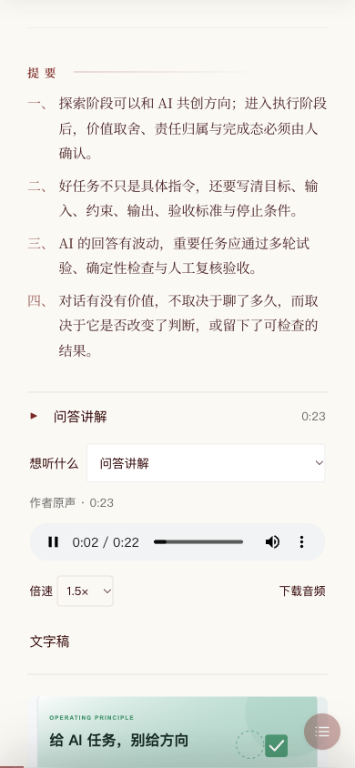
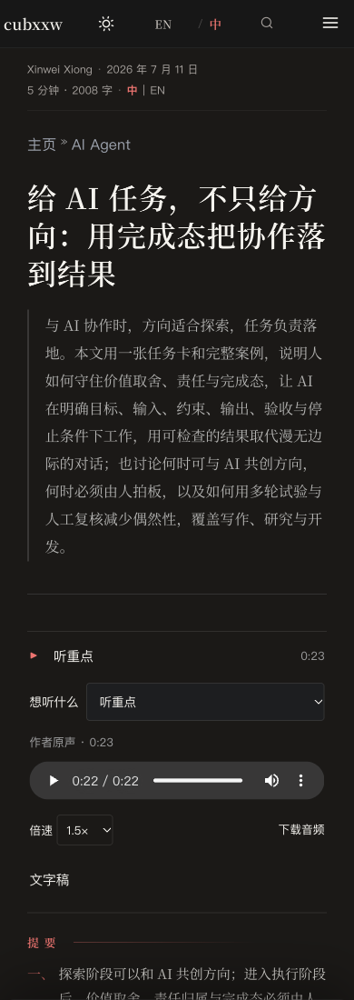

# 读者声音体验验收（2026-10-17）

本轮实现读者的三种入口：听重点、听这一节、问答讲解。声音由作者预先准备并确认，读者直接播放静态音频；同一篇的不同用途可共存，个人音色默认复用，网页不接触密钥。保留作者导语和后记的原有数据格式。

## 已验证

- 当前声音专项测试 25 项通过。覆盖音色复用、完整稿件分段、付费操作幂等、取消、真实章节范围、同文多用途、源文版本、稿件截断、中文音色元数据、Google 包装后的授权错误，以及 Hugo 的真实模板输出。
- 审阅修复后重新运行完整质量测试，183 项中 182 项通过、1 项原有跳过。
- Hugo 0.145.0 extended 全站构建通过，两种语言分别生成 344 和 367 个页面。播放器调整后再次构建通过。验收音频只在隔离工作区挂载，未加入产品文章。
- 真实浏览器访问全站构建出的文章页：初始所有音频 paused、readyState=0；点击后真实播放，样本时长 22.752 秒；切换用途时只有一段声音播放；章节按钮可以就地播放和暂停。
- 发现并修正切换用途丢失倍速的问题；复验三个音频均保持所选 1.5 倍速。另以独立的作者后记入口复验 2 倍速偏好跨入口保留，原生控件的速度变化也会同步保存。
- 刷新后不自动播放；主动打开播放器时，重点音频从之前保存的约 9.8 秒继续。
- 390px 布局的文档宽度为 390px，播放器宽度为 330px，无横向溢出；深色模式文字和控件可读。原生音频控件、文字稿与章节跳转保留。
- 隔离故障服务器对 MP3 返回 404：界面显示可读提示，文字稿仍能展开，文章仍可阅读。
- 作者工具刷新后可恢复真实整理出的 506 字讲解稿，不重复调用模型；没有个人音色时配音按钮保持禁用。
- 主工作区原有 235 个受保护文件逐一核对 SHA256，未发现变化。录音、授权、转录、任务及密钥未加入 Git。

上述播放器验收使用本机参考录音作为样本，**不是文章讲解，也不是复刻成功的声音**。没有把该样本挂入待发布的文章。

## Google 真实调用边界

Leafhour 同一份环境文件中的 Gemini 密钥可用，真实 `gemini-3.8-flash` 调用已根据公开文章整理出一份讲解稿。音色创建使用官方 `POST /v1beta/voices`，`store=true`、`type=replicated`、`gemini-3.8-flash-tts`，音频统一为 24kHz、单声道、16 位 WAV。

用户补充录音后，普通转录识别到完整中文授权语句，但专用音色核验仍返回 HTTP 500；错误详情指向授权句不匹配。裁切纯授权片段、改用同次录音中的自然说话参考，并添加中文语言元数据后，仍未返回个人声音 ID。随后查询保存的复刻音色为零。工具已将这一供应商错误转换成可操作提示，不自动重试，也不冒用现成音色。

因此，个人音色创建、真实复刻配音和音色相似度尚未验收。工具内提供官方英文授权句作为下一次本人录音的选项。此处不以模拟供应商测试、普通转录结果或网页播放成功代替音色核验。

## 界面证据

以下为本机实际博客布局中的隔离播放验收。截图不含密钥、个人声音 ID 或录音原件。

## 审阅

本轮按源文边界、密钥隔离、付费幂等、缓存复用、版本绑定、可访问性和错误恢复逐项自审，修复了浏览器发现的倍速问题。PR 的自动审阅另提出三项有效建议，已复现并修复：保留子目录部署的音频路径；以同目录临时文件及重命名写入文章和公开资产，保留文章权限并在切换前复查并发编辑；按章节标题及同名出现次数替换音频，避免正文前方增删行导致重复或误删其他章节。三项均加入回归检查。没有把自审写成独立评审，也不对尚未成功的个人音色给相似度分数。源码合并与线上发布状态由实际 PR 和部署记录另行确认。
